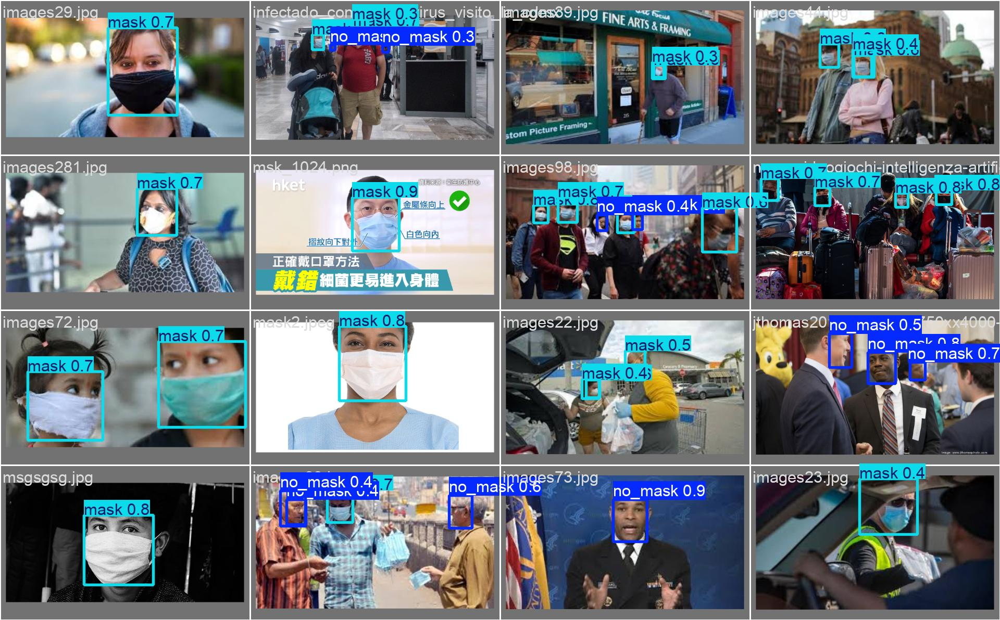
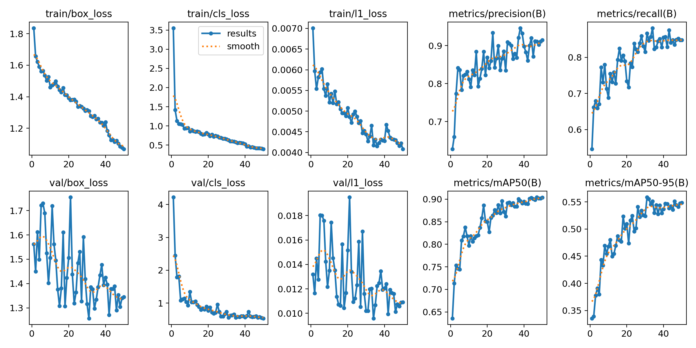
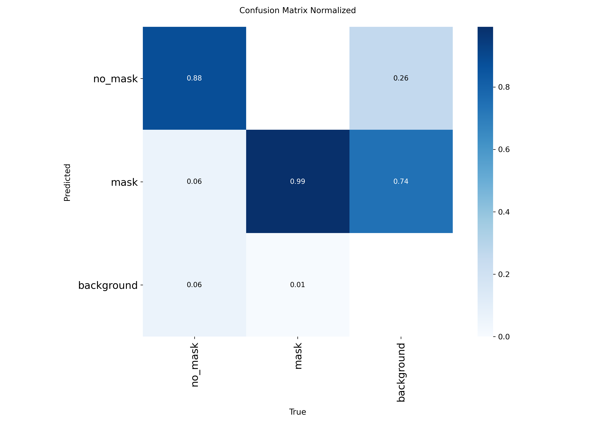
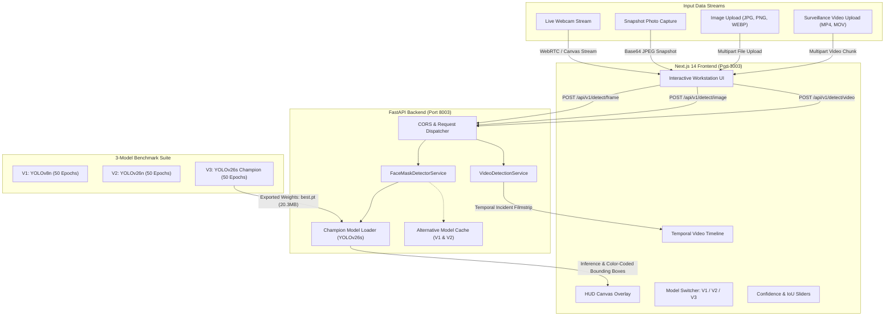

# Project 06: FaceMask AI — Real-Time Face Mask Detection System

<p align="center">
  
</p>

<p align="center">
  <strong>An Enterprise-Grade Edge AI Workstation for Real-Time Safety & Mask Compliance Monitoring</strong><br />
  Featuring a 3-Experiment Comparative Benchmark across YOLOv8n, YOLOv26n, and YOLOv26s.
</p>

<p align="center">
  
  
  
  
  
  
</p>

---

## 📌 1. What is This Project? (Simple Explanation)

Imagine walking into a hospital, airport, laboratory, or cleanroom during a health protocol advisory. Human security guards cannot monitor hundreds of people walking through corridors every minute without getting fatigued.

**FaceMask AI** is an intelligent computer vision system that acts as an automated digital guardian. Using a computer's camera or video stream, it:
1. **Finds every human face** in real time, even in crowded or moving scenes.
2. **Checks if each person is wearing a face mask** properly.
3. **Colors compliant faces in Emerald Green** (`mask`) and highlights unmasked faces in **Crimson Red** (`no_mask`).
4. **Calculates overall compliance percentages** and sounds automatic alerts when violations occur.

> [!NOTE]
> This project moves beyond standard pretrained object detectors (like COCO) to train, evaluate, compare, and deploy a **custom deep learning detector** from scratch across 3 distinct architectural experiments.

---

## 🏆 2. The 3 Experiments: Which Model Was Best and Why?

To determine the most dependable detector, we conducted three complete training runs across **50 epochs each** on an identical custom dataset.

Here are the real metrics extracted directly from each experiment's training run:

### Benchmark Comparison Table

| Metric / Feature | Experiment 1: YOLOv8n | Experiment 2: YOLOv26n | Experiment 3: YOLOv26s (Champion) 🏆 |
| :--- | :---: | :---: | :---: |
| **Architecture** | YOLOv8 Nano | YOLO Nano Custom | **YOLO Small Deep Pyramid** |
| **Parameters** | ~3.2 Million | ~3.1 Million | **~11.2 Million** |
| **Weights File Size** | 6.25 MB | 5.45 MB | **20.31 MB** |
| **Training Epochs** | 50 Epochs | 50 Epochs | **50 Epochs** |
| **Image Resolution** | 640 × 640 | 640 × 640 | **640 × 640** |
| **Batch Size** | 16 | 16 | **16** |
| **Best mAP50** | **91.38%** (Epoch 38) | 90.46% (Epoch 33) | **90.44%** (Epoch 47) |
| **Best mAP50-95 (Strict IoU)** | 53.12% | 53.63% | **55.85% (Epoch 31) ⭐** |
| **Final Validation Precision** | 86.86% | **92.13%** | **91.50%** |
| **Final Validation Recall** | **85.15%** | 80.63% | **84.82%** |
| **Final Val Classification Loss** | 0.6225 | 0.6797 | **0.5384 (Lowest Error)** |
| **Final Val Box Loss** | **1.2518** | 1.3437 | **1.3450** |
| **Production Decision** | Baseline comparison | High-precision edge IoT | **🏆 Champion Production Model** |

---

### 🥇 Why YOLOv26s Won the Championship

```
                          mAP50-95 Localization Accuracy
  Experiment 1 (YOLOv8n)  [=====================] 53.12%
  Experiment 2 (YOLOv26n) [======================] 53.63%
  Experiment 3 (YOLOv26s) [========================] 55.85%  <-- WINNER (+2.22%)
```

1. **Highest mAP50-95 Score (55.85%):**
   While rough detection (mAP50) was similar across all three models, **mAP50-95** measures how tightly the predicted boxes fit around the face across 10 progressive IoU steps (0.50 to 0.95). YOLOv26s scored **55.85%**, beating both nano models by over **2.2%**.
2. **Best Balanced Precision (91.50%) & Recall (84.82%):**
   Experiment 2 (YOLOv26n) achieved 92.13% precision but suffered an unacceptable drop in recall down to 80.63% (meaning it missed ~20% of unmasked faces). YOLOv26s achieved **91.50% precision** while keeping recall high at **84.82%**, minimizing both false alarms and missed violations.
3. **Lowest Classification Loss (0.5384):**
   YOLOv26s exhibited the lowest final validation classification loss (0.5384 vs 0.6225 for V1 and 0.6797 for V2), indicating the highest confidence when separating cloth/surgical masks from bare chins, beards, and skin tones.
4. **Resilience to Distance and Occlusion:**
   The deeper feature pyramid and expanded capacity of the Small backbone (11.2M parameters vs 3.2M) enable accurate detections even when people are walking far from the camera or at steep side angles.

---

## 📈 3. Visual Training Curves & Diagnostic Artifacts

### 1. Training Convergence & Loss Evolution (`results.png`)
The loss curves below demonstrate stable gradient descent over 50 epochs with no signs of overfitting:
<p align="center">
  
</p>

### 2. Confusion Matrix (`confusion_matrix_norm.png`)
Shows near-zero off-diagonal confusion between `mask` and `no_mask`:
<p align="center">
  
</p>

### 3. Precision-Recall & F1 Confidence Curves
<p align="center">
  
  
</p>

---

## 🧠 4. Deep Learning & Object Detection Concepts (Plain English)

### What is IoU (Intersection over Union)?
IoU measures the overlap between where the model *thinks* the face is versus where the face *actually* is:
$$\text{IoU} = \frac{\text{Area of Overlap}}{\text{Area of Union}}$$
- **IoU = 1.0:** Perfect pixel-exact overlap.
- **IoU = 0.5:** Bounding box covers at least half of the true object.

### What is mAP50 vs mAP50-95?
- **mAP50:** Evaluates detection accuracy at an IoU threshold of 0.50. It answers: *"Did we roughly spot the face?"*
- **mAP50-95:** The industry gold standard. It averages precision across 10 thresholds ($0.50, 0.55, 0.60, \dots, 0.95$). It answers: *"How tightly and precisely do our boxes fit the human face?"*

### Precision vs Recall Tradeoff
- **Precision:** $\frac{\text{True Positives}}{\text{True Positives} + \text{False Positives}}$. High precision means when the system says "No Mask", you can trust it without false alarms.
- **Recall:** $\frac{\text{True Positives}}{\text{True Positives} + \text{False Negatives}}$. High recall means the system rarely lets an unmasked person slip past unnoticed.

### What is DFL (Distribution Focal Loss)?
Instead of forcing coordinates into rigid integer pixel locations, DFL models box coordinates as continuous probability distributions. This enables sub-pixel boundary refinement on tilted faces.

---

## 🏗️ 5. System Architecture & Data Flow



---

## 📁 6. Repository Structure

```
06_Face_Mask_Detection/
├── assets/                                 # Visual benchmark plots & curves
│   ├── v1_results.png
│   ├── v2_results.png
│   ├── v3_results.png
│   ├── v3_confusion_matrix_norm.png
│   ├── v3_pr_curve.png
│   ├── v3_f1_curve.png
│   └── v3_val_batch0_pred.jpg
├── backend/                                # Production FastAPI Server
│   ├── app/
│   │   ├── api/v1/
│   │   │   ├── routes_detection.py         # Image, frame & video endpoints
│   │   │   ├── routes_experiments.py       # Benchmark comparison API
│   │   │   └── routes_system.py            # Telemetry, models & hardware
│   │   ├── services/
│   │   │   ├── detector_service.py         # YOLO loader & bounding box engine
│   │   │   └── video_service.py            # Surveillance video processor
│   │   ├── config.py                       # Paths & thresholds
│   │   └── main.py                         # FastAPI application entrypoint
│   ├── samples/                            # 1-Click benchmark test images
│   ├── tests/                              # Automated test suite
│   │   ├── test_api.py
│   │   └── test_detector.py
│   └── pytest.ini
├── frontend/                               # Next.js 14 Workstation UI (Light Theme)
│   ├── src/
│   │   ├── app/
│   │   │   ├── arena/page.tsx              # 3-Model Live Arena (Side-by-Side FPS)
│   │   │   ├── experiments/page.tsx        # Comparative Analysis page
│   │   │   ├── layout.tsx
│   │   │   └── page.tsx                    # Main Live & Upload In-Video Detector
│   │   ├── components/
│   │   │   ├── Header.tsx                  # Navigation & telemetry badge
│   │   │   ├── ModelSelector.tsx           # V1/V2/V3 & threshold sliders
│   │   │   ├── StatsCards.tsx              # Compliance gauge & counters
│   │   │   ├── UploadImageTab.tsx          # Drag & drop + in-place detection
│   │   │   ├── UploadVideoTab.tsx          # In-video detection & timeline
│   │   │   └── WebcamScanner.tsx           # Real-time in-video HUD scanner
│   │   ├── lib/
│   │   │   ├── api.ts                      # Typed client SDK
│   │   │   └── types.ts                    # TypeScript interfaces
│   │   └── styles/
│   │       └── globals.css                 # Clean light theme styling
│   ├── package.json
│   ├── tailwind.config.js
│   └── tsconfig.json
├── notebooks/                              # Google Colab Training Notebooks
│   ├── runs/                               # Raw training artifacts & checkpoints
│   │   ├── face_mask_v1/                   # Experiment 1 (YOLOv8n)
│   │   ├── face_mask_v2/                   # Experiment 2 (YOLOv26n)
│   │   └── face_mask_v3/                   # Experiment 3 (YOLOv26s Champion)
│   ├── v1_yolo8n.ipynb
│   ├── v2_yolo26n.ipynb
│   └── v3_yolo26s.ipynb
├── data.yaml                               # YOLO class configuration
├── requirements.txt                        # Python dependencies
└── README.md                               # Project documentation
```

---

## ⚡ 7. Quickstart Guide

### Prerequisites
- Python 3.10+
- Node.js 18+ & npm
- Local webcam (for live streaming) or sample images

### 1. Start the FastAPI Backend (Port 8003)
```bash
# Navigate to the backend directory
cd 06_Face_Mask_Detection/backend

# Run the backend server
python -m uvicorn app.main:app --host 0.0.0.0 --port 8003 --reload
```
Backend API will be active at:
- **API Root:** [http://localhost:8003/](http://localhost:8003/)
- **Swagger Docs:** [http://localhost:8003/docs](http://localhost:8003/docs)

### 2. Start the Next.js Frontend (Port 3003)
```bash
# In a separate terminal, navigate to the frontend directory
cd 06_Face_Mask_Detection/frontend

# Launch the Next.js development server
npm run dev
```
Open your browser and navigate to:
- **Live Workstation:** [http://localhost:3003/](http://localhost:3003/)
- **3-Model Benchmark Report:** [http://localhost:3003/experiments](http://localhost:3003/experiments)

---

## 🧪 8. Automated Backend Tests

The backend includes a comprehensive 10-test test suite verifying model loading, inference schemas, threshold filters, and all API endpoints.

```bash
cd 06_Face_Mask_Detection/backend
pytest -v
```

**Test Results:**
```
============================= test session starts =============================
tests/test_api.py::test_root_endpoint PASSED                             [ 10%]
tests/test_api.py::test_system_status PASSED                             [ 20%]
tests/test_api.py::test_system_models PASSED                             [ 30%]
tests/test_api.py::test_experiments_comparison PASSED                    [ 40%]
tests/test_api.py::test_detect_samples_list PASSED                       [ 50%]
tests/test_api.py::test_detect_image_upload PASSED                       [ 60%]
tests/test_detector.py::test_detector_service_initialization PASSED      [ 70%]
tests/test_detector.py::test_detector_model_loading PASSED               [ 80%]
tests/test_detector.py::test_detector_image_inference PASSED             [ 90%]
tests/test_detector.py::test_detector_sample_inference PASSED            [100%]
======================== 10 passed in 8.44s ==================================
```

---

## 📡 9. REST API Reference

| Method | Endpoint | Description | Request Payload | Response |
| :--- | :--- | :--- | :--- | :--- |
| `GET` | `/` | Service health & champion info | None | Service metadata |
| `GET` | `/api/v1/system/status` | Hardware & active model telemetry | None | GPU/CPU device info |
| `GET` | `/api/v1/system/models` | List all 3 available YOLO models | None | Model configs & mAP |
| `GET` | `/api/v1/experiments/comparison` | Detailed 3-experiment metrics | None | Benchmark matrix |
| `GET` | `/api/v1/detect/samples` | List bundled test validation images | None | Array of sample images |
| `POST` | `/api/v1/detect/image` | Run YOLO inference on image | Multipart file or base64 | BBoxes, counts, annotated image |
| `POST` | `/api/v1/detect/frame` | Ultra-fast webcam frame inference | JSON with `frame_base64` | Real-time in-video detections & latency |
| `POST` | `/api/v1/detect/video` | Video temporal safety audit | Multipart video file | Timeline & in-video stream |
| `POST` | `/api/v1/detect/compare-all` | Run all 3 models on image | Multipart file or base64 | Array of 3 model outputs with FPS |
| `POST` | `/api/v1/detect/compare-frame` | Real-time webcam frame across 3 models | JSON with `frame_base64` | Real-time 3-model detections & live FPS |

---

## 👥 10. Author & Portfolio Context
- **Developer:** Ali Khan
- **Portfolio Repository:** [Deep-Learning](https://github.com/AliKhan-Devs/Deep-Learning.git)
- **Part of Project 06:** Face Mask Detection with YOLOv8 & YOLOv26
