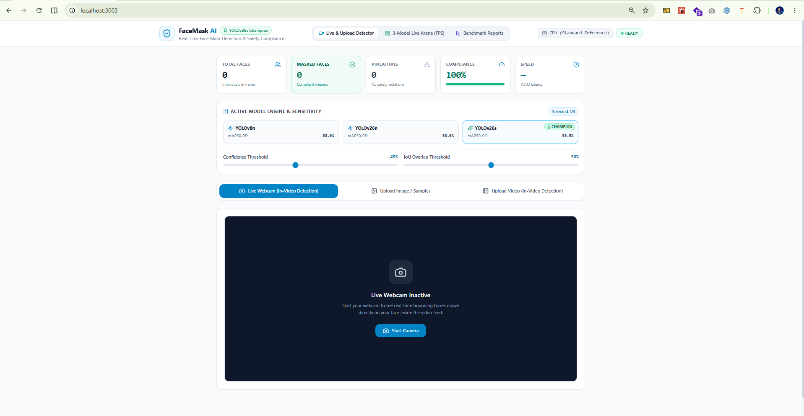
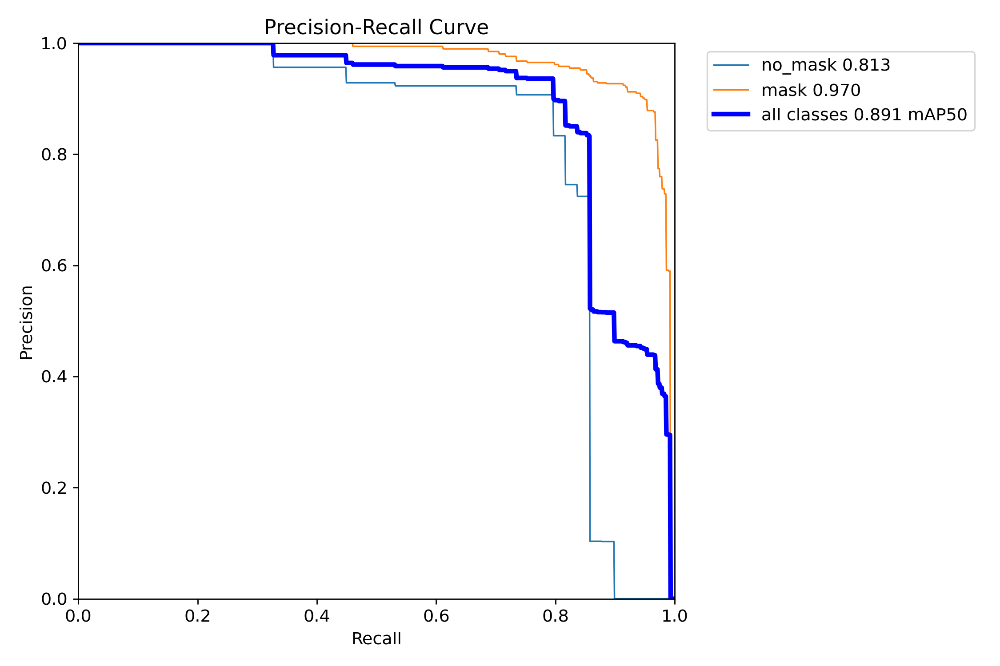
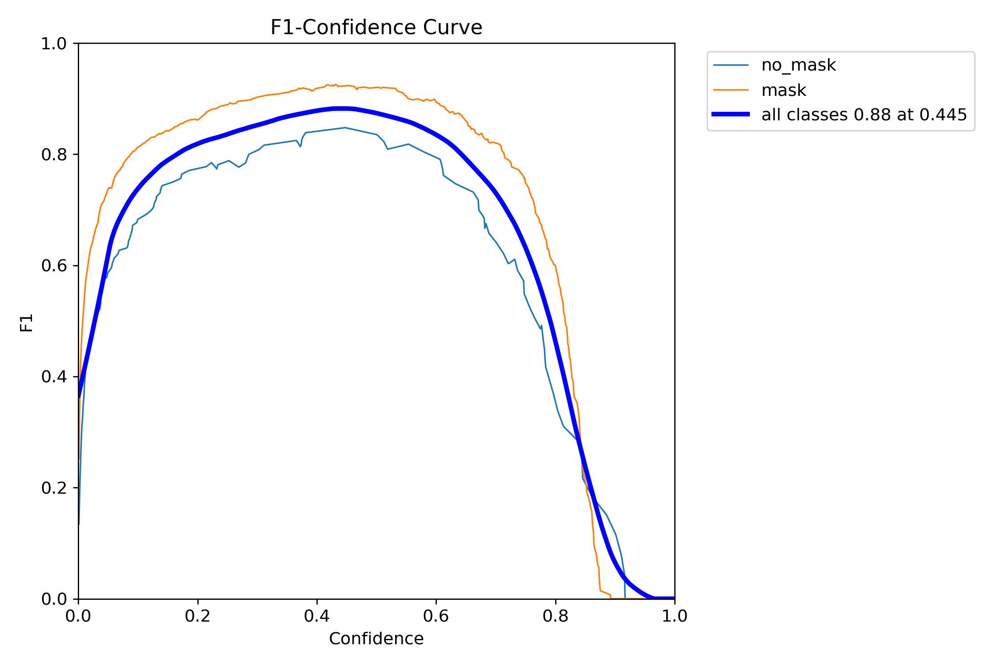
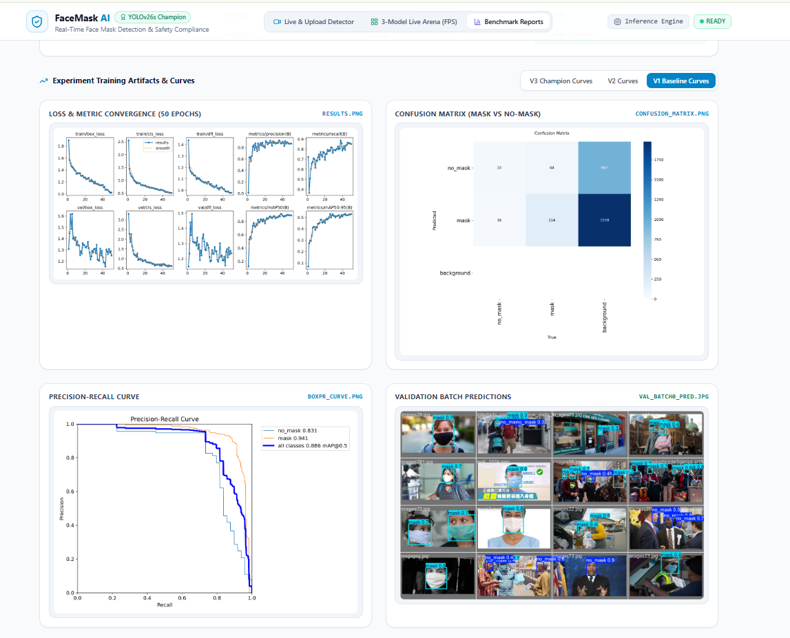
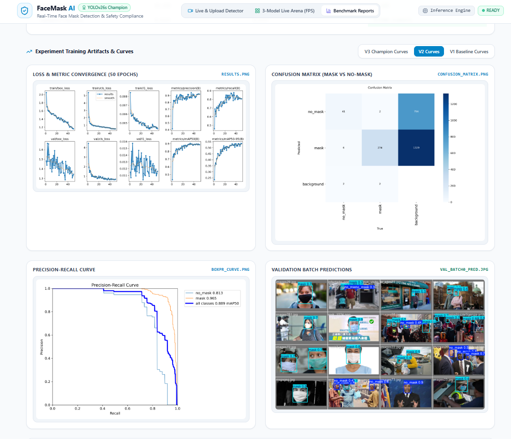
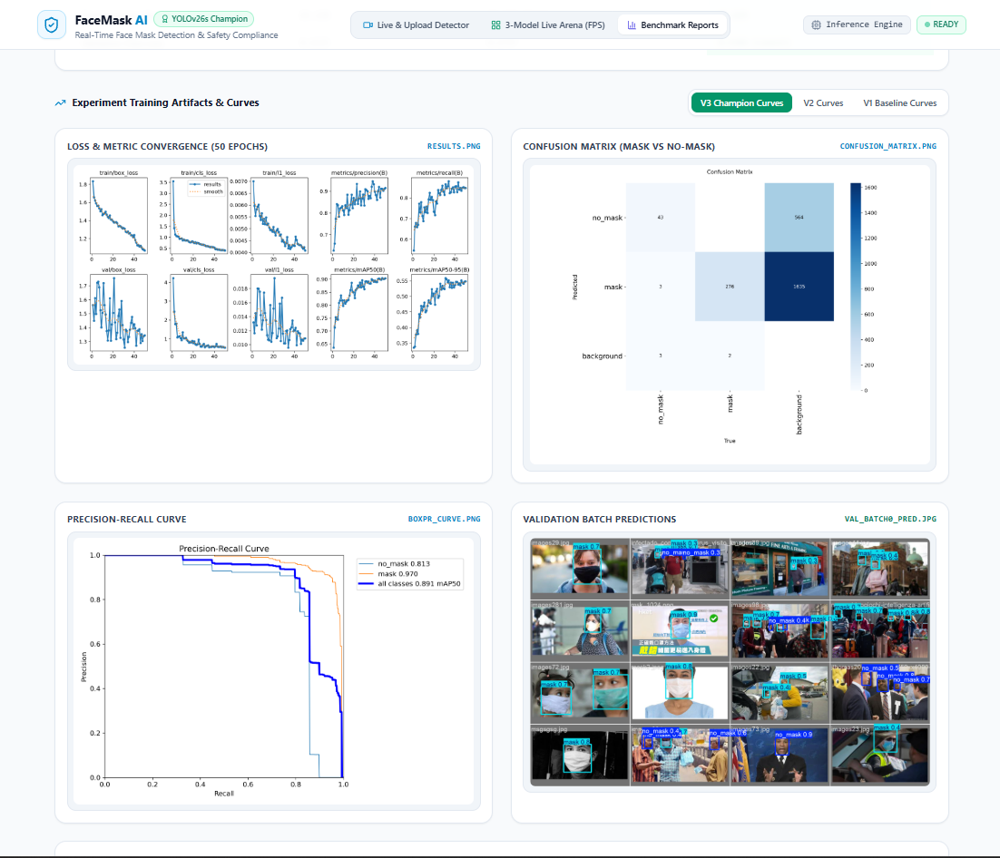
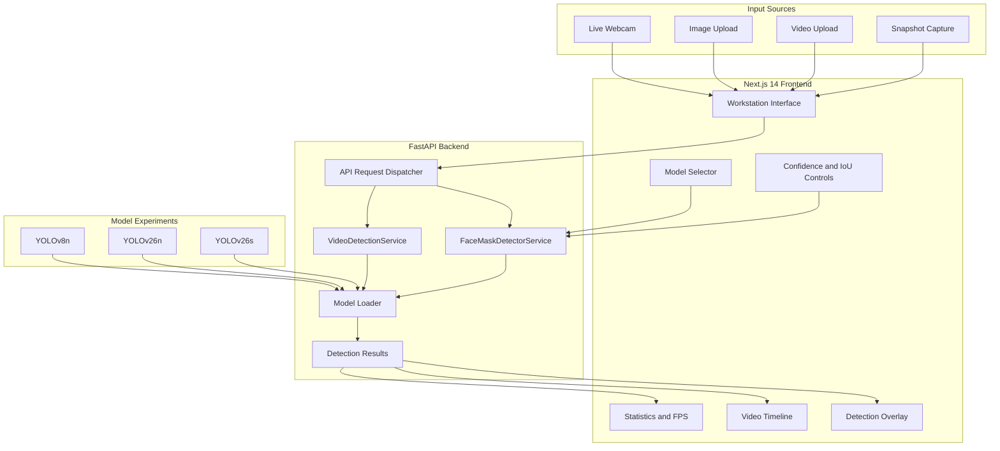

# Project 06: FaceMask AI — Real-Time Face Mask Detection System

<p align="center">
  
</p>

<p align="center">
  <strong>A Computer Vision Application for Real-Time Face Mask Detection and Model Comparison</strong><br />
  Featuring a Three-Experiment Benchmark across YOLOv8n, YOLOv26n, and YOLOv26s.
</p>

<p align="center">
  
  
  
  
  
  
</p>

---

## 1. Project Overview

FaceMask AI is a computer vision application that detects human faces and classifies them into two categories:

- **Mask:** A person is wearing a face mask.
- **No Mask:** A person is not wearing a face mask.

The system processes images, uploaded videos, and webcam streams. Detected faces are displayed with color-coded bounding boxes:

- Green: Mask detected.
- Red: No mask detected.

The application also calculates detection statistics, displays compliance percentages, and provides alerts when unmasked faces are detected.

The primary goal of this project was not only to build a working detection system but also to train, evaluate, and compare three YOLO model configurations under the same experimental setup.

### Key Features

- Real-time webcam face mask detection.
- Image upload and detection.
- Video upload and frame-by-frame detection.
- Three-model comparison interface.
- Live FPS comparison.
- Configurable confidence and IoU thresholds.
- Detection statistics and compliance monitoring.
- FastAPI backend with automated tests.
- Interactive Next.js frontend.

---

## 2. Three-Model Comparative Benchmark

One of the main parts of this project was conducting three separate training experiments to compare model performance.

Each model was trained for 50 epochs using the same custom dataset and training configuration.

### Experimental Configuration

| Setting | Value |
|---|---|
| Dataset | Custom face mask dataset |
| Image Size | 640 × 640 |
| Batch Size | 16 |
| Training Epochs | 50 |
| Models | YOLOv8n, YOLOv26n, YOLOv26s |
| Evaluation | Validation metrics |

### Benchmark Comparison

The following metrics were collected from the three experiments.

| Metric | YOLOv8n | YOLOv26n | YOLOv26s |
|---|---:|---:|---:|
| Architecture | YOLOv8 Nano | YOLOv26 Nano | YOLOv26 Small |
| Parameters | ~3.2M | ~3.1M | ~11.2M |
| Weights Size | 6.25 MB | 5.45 MB | 20.31 MB |
| Training Epochs | 50 | 50 | 50 |
| Image Resolution | 640 × 640 | 640 × 640 | 640 × 640 |
| Batch Size | 16 | 16 | 16 |
| Best mAP50 | **91.38%** | 90.46% | 90.44% |
| Best mAP50-95 | 53.12% | 53.63% | **55.85%** |
| Final Validation Precision | 86.86% | **92.13%** | 91.50% |
| Final Validation Recall | **85.15%** | 80.63% | 84.82% |
| Final Validation Classification Loss | 0.6225 | 0.6797 | **0.5384** |
| Final Validation Box Loss | **1.2518** | 1.3437 | 1.3450 |

**Metric reporting note:** Best mAP50 and mAP50-95 are the best recorded values during training. Precision, recall, classification loss, and box loss are the final validation values reported for each experiment. These metrics should not be interpreted as measurements from the same epoch.

### What Did the Experiments Show?

Each model demonstrated different strengths.

**Experiment 1 — YOLOv8n**

- Achieved the highest mAP50 of 91.38%.
- Achieved the highest final validation recall of 85.15%.
- Had the smallest final validation box loss of 1.2518.

**Experiment 2 — YOLOv26n**

- Achieved the highest final validation precision of 92.13%.
- Had the smallest model file size at 5.45 MB.
- Achieved a mAP50-95 score of 53.63%.

**Experiment 3 — YOLOv26s**

- Achieved the highest mAP50-95 of 55.85%.
- Achieved the lowest final validation classification loss of 0.5384.
- Had a larger model size and parameter count than the Nano configurations.

### Selected Inference Model

YOLOv26s was selected as the application's primary inference model because it achieved the highest mAP50-95 score among the three experiments.

However, the results do not establish one universally best model:

- YOLOv8n performed best in mAP50 and recall.
- YOLOv26n performed best in precision and model file size.
- YOLOv26s performed best in mAP50-95 and final classification loss.

The appropriate model therefore depends on the deployment requirements, including localization quality, precision, recall, inference speed, and hardware constraints.

---

## 3. Training Results and Evaluation

The project includes training and evaluation artifacts from all three experiments.

### 3.1 Training Curves

The YOLOv26s training results plot provides an overview of the model's training and validation behavior over 50 epochs.

<p align="center">
  
</p>

### 3.2 Confusion Matrix

The normalized confusion matrix shows how the model classified the two target classes: `mask` and `no_mask`.

<p align="center">
  
</p>

### 3.3 Precision-Recall Curve

The precision-recall curve illustrates the relationship between precision and recall at different confidence thresholds.

<p align="center">
  
</p>

### 3.4 F1-Confidence Curve

The F1-confidence curve illustrates how the F1 score changes with different confidence thresholds.

<p align="center">
  
</p>

### 3.5 Empirical Validation Metric Sheets

The detailed validation summaries recorded during training across the three experiments:

<details open>
<summary><strong>Experiment 1: YOLOv8n Validation Metrics</strong></summary>
<br />
<p align="center">
  
</p>
</details>

<details open>
<summary><strong>Experiment 2: YOLOv26n Validation Metrics</strong></summary>
<br />
<p align="center">
  
</p>
</details>

<details open>
<summary><strong>Experiment 3: YOLOv26s Validation Metrics</strong></summary>
<br />
<p align="center">
  
</p>
</details>

---

## 4. Deep Learning and Object Detection Concepts

This project provided practical experience with several important computer vision and object detection concepts.

### Intersection over Union (IoU)

IoU measures the overlap between a predicted bounding box and the ground-truth bounding box.

\[
IoU = \frac{\text{Area of Intersection}}{\text{Area of Union}}
\]

A higher IoU indicates better overlap between the predicted and actual object locations.

### mAP50 vs mAP50-95

**mAP50**

Evaluates detection performance at an IoU threshold of 0.50.

It measures how well the model detects objects when a relatively moderate bounding-box overlap is accepted.

**mAP50-95**

Calculates mean Average Precision across multiple IoU thresholds, from 0.50 to 0.95 in increments of 0.05.

It provides a more demanding evaluation of both detection and localization quality.

### Precision vs Recall

**Precision**

\[
Precision = \frac{TP}{TP + FP}
\]

Measures how many of the model's positive predictions are correct.

**Recall**

\[
Recall = \frac{TP}{TP + FN}
\]

Measures how many of the actual positive instances the model successfully detects.

### Distribution Focal Loss (DFL)

Distribution Focal Loss is used in object detection to improve bounding-box localization.

Instead of directly predicting bounding-box coordinates as simple values, the model uses a distribution-based representation to estimate object boundaries.

---

## 5. System Architecture

FaceMask AI is built using a separate frontend and backend architecture.

- **Frontend:** Next.js 14
- **Backend:** FastAPI
- **Detection:** Ultralytics YOLO
- **Image Processing:** OpenCV and NumPy
- **Model Training:** Python and Google Colab

### Data Flow



### Detection Workflow

1. The user provides an image, video, or webcam stream.
2. The frontend sends the required data to the FastAPI backend.
3. The backend processes the request through the appropriate detection service.
4. The selected YOLO model performs inference.
5. The backend returns detection information, bounding boxes, class labels, confidence scores, and relevant image or video results.
6. The frontend displays the annotated results and updates its statistics.

---

## 6. Technology Stack

| Category | Technologies |
|---|---|
| Programming Language | Python |
| Deep Learning | PyTorch |
| Object Detection | Ultralytics YOLO |
| Backend | FastAPI |
| Frontend | Next.js 14, React |
| Language / UI | TypeScript |
| Styling | Tailwind CSS |
| Image Processing | OpenCV, NumPy |
| Model Training | Google Colab |
| Testing | Pytest |

---

## 7. Repository Structure

```text
06_Face_Mask_Detection/
│
├── assets/
│   ├── landing_page.png
│   ├── test_image_1.png
│   ├── v1_metrices.png
│   ├── v1_results.png
│   ├── v2_metrices.png
│   ├── v2_results.png
│   ├── v3_metrices.png
│   ├── v3_results.png
│   ├── v3_confusion_matrix_norm.png
│   ├── v3_pr_curve.png
│   ├── v3_f1_curve.png
│   └── v3_val_batch0_pred.jpg
│
├── backend/
│   ├── app/
│   │   ├── api/
│   │   │   └── v1/
│   │   │       ├── routes_detection.py
│   │   │       ├── routes_experiments.py
│   │   │       └── routes_system.py
│   │   │
│   │   ├── services/
│   │   │   ├── detector_service.py
│   │   │   └── video_service.py
│   │   │
│   │   ├── config.py
│   │   └── main.py
│   │
│   ├── samples/
│   ├── tests/
│   │   ├── test_api.py
│   │   └── test_detector.py
│   │
│   └── pytest.ini
│
├── frontend/
│   ├── src/
│   │   ├── app/
│   │   │   ├── arena/
│   │   │   │   └── page.tsx
│   │   │   ├── experiments/
│   │   │   │   └── page.tsx
│   │   │   ├── layout.tsx
│   │   │   └── page.tsx
│   │   │
│   │   ├── components/
│   │   │   ├── Header.tsx
│   │   │   ├── ModelSelector.tsx
│   │   │   ├── StatsCards.tsx
│   │   │   ├── UploadImageTab.tsx
│   │   │   ├── UploadVideoTab.tsx
│   │   │   └── WebcamScanner.tsx
│   │   │
│   │   ├── lib/
│   │   │   ├── api.ts
│   │   │   └── types.ts
│   │   │
│   │   └── styles/
│   │       └── globals.css
│   │
│   ├── package.json
│   ├── tailwind.config.js
│   └── tsconfig.json
│
├── notebooks/
│   ├── runs/
│   │   ├── face_mask_v1/
│   │   ├── face_mask_v2/
│   │   └── face_mask_v3/
│   │
│   ├── v1_yolo8n.ipynb
│   ├── v2_yolo26n.ipynb
│   └── v3_yolo26s.ipynb
│
├── data.yaml
├── requirements.txt
└── README.md
```

---

## 8. Getting Started

### Prerequisites

Make sure you have the following installed:

- Python 3.10+
- Node.js 18+
- npm
- A webcam for live detection (optional)
- Trained model weights

### 8.1 Clone the Repository

```bash
git clone https://github.com/AliKhan-Devs/Deep-Learning.git

cd Deep-Learning/06_Face_Mask_Detection
```

### 8.2 Install Backend Dependencies

```bash
pip install -r requirements.txt
```

### 8.3 Configure Model Weights

Place the trained YOLO model weights in the locations expected by the backend configuration.

The three experiments use their respective trained weights:

- YOLOv8n
- YOLOv26n
- YOLOv26s

The primary inference configuration uses YOLOv26s, while the alternative models are available for comparison.

### 8.4 Start the FastAPI Backend

Navigate to the backend directory:

```bash
cd backend
```

Start the server:

```bash
python -m uvicorn app.main:app --host 0.0.0.0 --port 8003 --reload
```

Backend API:

- API Root: `http://localhost:8003/`
- Swagger Documentation: `http://localhost:8003/docs`

### 8.5 Start the Next.js Frontend

Open another terminal:

```bash
cd frontend
```

Install dependencies:

```bash
npm install
```

Start the development server:

```bash
npm run dev
```

Open the application:

- Main Workstation: `http://localhost:3003/`
- Three-Model Comparison: `http://localhost:3003/experiments`
- Live Model Arena: `http://localhost:3003/arena`

---

## 9. Automated Backend Tests

The backend includes automated tests covering model initialization, inference, API endpoints, and response behavior.

Run the tests:

```bash
cd backend

pytest -v
```

### Test Results

```text
============================= test session starts =============================

tests/test_api.py::test_root_endpoint PASSED
tests/test_api.py::test_system_status PASSED
tests/test_api.py::test_system_models PASSED
tests/test_api.py::test_experiments_comparison PASSED
tests/test_api.py::test_detect_samples_list PASSED
tests/test_api.py::test_detect_image_upload PASSED
tests/test_detector.py::test_detector_service_initialization PASSED
tests/test_detector.py::test_detector_model_loading PASSED
tests/test_detector.py::test_detector_image_inference PASSED
tests/test_detector.py::test_detector_sample_inference PASSED

============================= 10 passed in 8.44s ==============================
```

---

## 10. REST API Reference

The FastAPI backend exposes endpoints for detection, model information, system status, and experiment comparisons.

| Method | Endpoint | Description |
|---|---|---|
| GET | `/` | Service health and model information |
| GET | `/api/v1/system/status` | Hardware and active model telemetry |
| GET | `/api/v1/system/models` | Available YOLO models and configurations |
| GET | `/api/v1/experiments/comparison` | Three-experiment benchmark metrics |
| GET | `/api/v1/detect/samples` | List available sample images |
| POST | `/api/v1/detect/image` | Run detection on an uploaded image |
| POST | `/api/v1/detect/frame` | Run inference on a webcam frame |
| POST | `/api/v1/detect/video` | Process an uploaded video |
| POST | `/api/v1/detect/compare-all` | Compare all three models on an image |
| POST | `/api/v1/detect/compare-frame` | Compare all three models on a webcam frame |

For request schemas and response details, visit the FastAPI Swagger documentation at:

`http://localhost:8003/docs`

---

## 11. What I Learned

Through this project, I gained practical experience in:

- Training custom YOLO object detection models.
- Comparing different model architectures and sizes.
- Understanding mAP50 and mAP50-95 evaluation.
- Interpreting precision, recall, and loss metrics.
- Working with confusion matrices and evaluation curves.
- Building image, video, and webcam inference pipelines.
- Integrating trained deep learning models into a FastAPI backend.
- Developing an interactive Next.js application.
- Writing automated backend tests.
- Evaluating trade-offs between detection performance and model size.

---

## 12. Future Improvements

Some potential areas for further development include:

- Testing model inference performance on different hardware configurations.
- Measuring end-to-end latency under different workloads.
- Exploring model quantization for edge deployment.
- Evaluating performance on more diverse real-world environments.
- Expanding the evaluation with additional datasets and test conditions.

---

## 13. Project Information

**Developer:** Ali Khan

**Project:** FaceMask AI — Real-Time Face Mask Detection System

**Portfolio Repository:** [Deep-Learning](https://github.com/AliKhan-Devs/Deep-Learning)

**Project Directory:** `06_Face_Mask_Detection`

**Models Compared:** YOLOv8n, YOLOv26n, YOLOv26s

**Primary Application Model:** YOLOv26s

**Backend:** FastAPI

**Frontend:** Next.js 14

---

*Part of my ongoing Deep Learning and Computer Vision portfolio.*