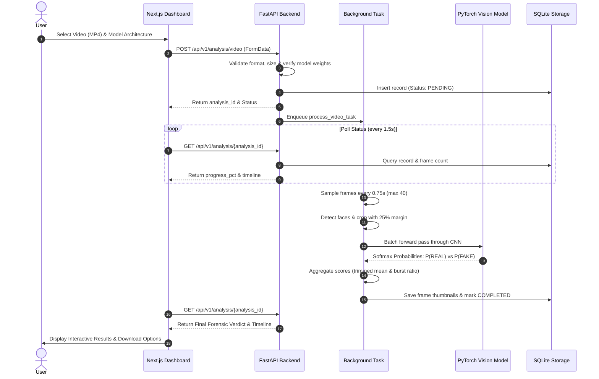

# Project 07 — DeepGuard AI: Deepfake Image & Video Detection System

[](https://fastapi.tiangolo.com)
[](https://pytorch.org)
[](https://nextjs.org)
[](https://opencv.org)
[](LICENSE)

> A production-grade AI digital forensics system designed to detect and analyze facial manipulation in images and video streams using fine-tuned deep convolutional neural networks.

---

## Table of Contents
1. [Project Introduction](#1-project-introduction)
2. [Problem Statement](#2-problem-statement)
3. [Motivation](#3-motivation)
4. [Main Objectives](#4-main-objectives)
5. [Key Features](#5-key-features)
6. [Technology Stack](#6-technology-stack)
7. [System Architecture](#7-system-architecture)
8. [Complete Processing Workflow](#8-complete-processing-workflow)
9. [Deep Learning Model Architectures](#9-deep-learning-model-architectures)
10. [Dataset Descriptions & Access Procedures](#10-dataset-descriptions--access-procedures)
11. [Repository Structure](#11-repository-structure)
12. [Cloud Training Workflow (Google Colab)](#12-cloud-training-workflow-google-colab)
13. [Model Checkpoint Download Instructions](#13-model-checkpoint-download-instructions)
14. [Local Setup Instructions](#14-local-setup-instructions)
15. [Backend Execution](#15-backend-execution)
16. [Frontend Execution](#16-frontend-execution)
17. [Docker & Containerized Deployment](#17-docker--containerized-deployment)
18. [API Documentation](#18-api-documentation)
19. [Evaluation Methodology](#19-evaluation-methodology)
20. [Results & Benchmark Log](#20-results--benchmark-log)
21. [Known Limitations](#21-known-limitations)
22. [Future Improvements](#22-future-improvements)
23. [References & Research Papers](#23-references--research-papers)

---

## 1. Project Introduction

**DeepGuard AI** is a deep learning-powered digital forensics system developed to detect facial manipulation and synthetic identity swaps across static imagery and dynamic video recordings. 

Building upon the deep learning learning progression of this portfolio—from handwritten digit recognition to transfer learning with ResNet18 and real-time custom YOLOv8 object detection—DeepGuard AI tackles the critical real-world challenge of **synthetic media verification**.

The system combines fine-tuned computer vision backbones (**EfficientNet-B0** and **XceptionNet**) with face detection, controlled frame sampling, and an outlier-resilient aggregation algorithm, deployed behind a high-performance **FastAPI** backend and an intuitive **Next.js** forensic analysis dashboard.

---

## 2. Problem Statement

Recent advances in Generative Adversarial Networks (GANs), autoencoders, and diffusion-based rendering have democratized the ability to generate hyper-realistic synthetic media (deepfakes). While these technologies offer creative utility in cinematography and virtual entertainment, their weaponization poses existential threats:
- **Identity Fraud & Impersonation:** Fabricating biometric identity proofs for unauthorized access.
- **Disinformation & Propaganda:** Falsifying statements by public officials or corporate executives.
- **Reputational Harm:** Non-consensual synthetic image generation and blackmail.
- **Erosion of Evidentiary Trust:** Undermining public confidence in legitimate photographic and video evidence.

Manual visual inspection is increasingly incapable of detecting modern generative techniques. An automated, reproducible, and explainable computational forensic pipeline is required.

---

## 3. Motivation

Most online deepfake tutorials treat detection as a simplistic binary image classification toy problem, relying on random frame shuffling and single-frame max-pooling. However, real-world forensic deployment presents unique engineering challenges:
1. **Severe Data Leakage:** Random frame splitting allows networks to memorize actor identities rather than forgery artifacts, generating false 99% accuracies that collapse on unseen individuals.
2. **Video Compression Degradation:** Social media video re-encoding (H.264/H.265 compression) washes out high-frequency spatial boundaries.
3. **Temporal Inconsistency:** Deepfakes often flicker across time; naive average pooling dilutes brief malicious swaps, while max-pooling triggers false alarms on innocent compression glitches.
4. **Generalization Gap:** Models trained on one generation paradigm (e.g., autoencoders) frequently fail on another (e.g., GANs or 3D FaceSwap).

DeepGuard AI was conceived to bridge the gap between academic research concepts and production engineering.

---

## 4. Main Objectives

- **Systematic Architecture:** Implement and compare two distinct forensic architectures: EfficientNet-B0 (parameter-efficient, fast CPU latency) and XceptionNet (depthwise separable convolutions sensitive to high-frequency blending seams).
- **Leak-Free Training Pipeline:** Enforce strict identity-based grouping to guarantee zero actor leakage across training, validation, and test partitions.
- **Temporal Video Forensics:** Implement controlled frame extraction and outlier-resilient score aggregation (trimmed mean and sustained suspicious burst triggers).
- **Verifiable Engineering Standards:** Strictly decouple training from deployment; missing model checkpoints return explicit instructions rather than fabricated confidence numbers.
- **Exportable Forensic Evidence:** Produce downloadable structured JSON reports and printable HTML certificates summarizing biometric boundaries, frame timelines, and model metrics.

---

## 5. Key Features

- **Multi-Face Detection & Boundary Expansion:** Automatically detects all faces in frame and applies a 25% margin expansion to encapsulate forehead hairlines and jawlines where blending boundaries cluster.
- **Controlled Video Frame Sampling:** Prevents memory exhaustion by sampling at configurable intervals (e.g., 1 frame per 0.75s) up to a safety ceiling (40 frames).
- **Asynchronous Non-Blocking Processing:** Video ingestion initiates background worker jobs with real-time polling endpoints (`PENDING` $\to$ `PROCESSING` $\to$ `COMPLETED`).
- **Interactive Forensic Dashboard:** Drag-and-drop upload, face bounding box viewer with confidence tags, video frame timeline scrubber, and summary statistics.
- **Hardware-Aware Execution:** Automatically runs on CUDA GPUs when available; seamlessly falls back to CPU execution for portable local inspection.
- **Auditable SQLite History:** Stores all past analyses, frame thumbnails, and metrics in a lightweight local database.

---

## 6. Technology Stack

### Deep Learning & Machine Learning
- **Python**: 3.11 / 3.14
- **PyTorch**: Core deep learning tensor and neural network computation framework.
- **TorchVision**: Pretrained EfficientNet-B0 weights and image transformations.
- **timm**: PyTorch Image Models library supplying genuine XceptionNet architecture.
- **scikit-learn**: ROC-AUC, F1-Score, Precision, Recall, and Confusion Matrix calculation.
- **NumPy & Pandas**: Data manipulation and deterministic identity split manifests.
- **Matplotlib**: Loss curves, ROC curves, and confusion matrix visualizations.

### Computer Vision & Video Processing
- **OpenCV (cv2)**: Video frame decoding, FPS extraction, and Haar Cascade face detection.
- **Pillow (PIL)**: High-fidelity image manipulation and format normalization.

### Backend Infrastructure
- **FastAPI**: Modern, asynchronous Python web framework for REST API endpoints.
- **Pydantic (v2)**: Strict data validation and schema serialization.
- **Uvicorn**: Lightning-fast ASGI production web server.
- **SQLite**: Local persistence for analysis history and video frame records.

### Frontend Application
- **Next.js (14+)**: React framework utilizing App Router architecture.
- **TypeScript**: Type-safe frontend component architecture.
- **Tailwind CSS**: Modern cyber-forensics dark theme styling.
- **Lucide React**: Clean iconography for forensic dashboards.

---

## 7. System Architecture

```text
DeepGuard AI System Architecture

       ┌────────────────────────────────────────────────────────┐
       │                 Next.js Frontend (3000)                │
       │    Dashboard  •  Image Analysis  •  Video Analysis     │
       └──────────────────────────┬─────────────────────────────┘
                                  │  REST API (HTTP / JSON / FormData)
                                  ▼
       ┌────────────────────────────────────────────────────────┐
       │                  FastAPI Backend (8000)                │
       │   Routes: /analysis/image  /analysis/video  /models    │
       └──────────────┬───────────────────────────┬─────────────┘
                      │                           │
          Synchronous │               Asynchronous│ BackgroundTasks
                      ▼                           ▼
       ┌────────────────────────┐   ┌───────────────────────────┐
       │ Image Inference Engine │   │  Video Processing Worker  │
       │  • Face Detector       │   │   • Video Frame Sampler   │
       │  • 25% Margin Crop     │   │   • Face Detection & Crop │
       │  • Normalization       │   │   • Batch PyTorch Forward │
       │  • PyTorch Forward     │   │   • Outlier Aggregator    │
       └──────────────┬─────────┘   └─────────────┬─────────────┘
                      │                           │
                      └─────────────┬─────────────┘
                                    │
                                    ▼
       ┌────────────────────────────────────────────────────────┐
       │                Core Services & Storage                 │
       │  • ModelManager (EfficientNet-B0 & XceptionNet weights)│
       │  • SQLite Database (analyses & video_frames tables)    │
       │  • ReportService (JSON data & Printable HTML report)   │
       └────────────────────────────────────────────────────────┘
```

---

## 8. Complete Processing Workflow



---

## 9. Deep Learning Model Architectures

### 9.1 EfficientNet-B0
- **Source:** Pretrained ImageNet-1k weights from `torchvision.models`.
- **Compound Scaling:** Uniformly balances network depth, width, and resolution using compound coefficient scaling.
- **Classification Head Adaptation:** The original 1,000-class linear projection is replaced with:
  ```python
  nn.Sequential(
      nn.Dropout(p=0.3, inplace=True),
      nn.Linear(in_features=1280, out_features=2)
  )
  ```
- **Input Specs:** 224 × 224 × 3 pixels, normalized with ImageNet statistics ($\mu = [0.485, 0.456, 0.406]$, $\sigma = [0.229, 0.224, 0.225]$).

### 9.2 XceptionNet
- **Source:** Pretrained weights initialized via `timm.create_model('xception')`.
- **Depthwise Separable Convolutions:** Decouples spatial cross-channel correlations from depth correlations. In deepfake analysis, this architecture has demonstrated exceptional sensitivity to high-frequency spatial boundaries and color discrepancies.
- **Classification Head Adaptation:**
  ```python
  nn.Sequential(
      nn.Dropout(p=0.4, inplace=True),
      nn.Linear(in_features=2048, out_features=2)
  )
  ```
- **Input Specs:** 299 × 299 × 3 pixels, normalized to $[-1, 1]$ ($\mu = [0.5, 0.5, 0.5]$, $\sigma = [0.5, 0.5, 0.5]$).

---

## 10. Dataset Descriptions & Access Procedures

### 10.1 FaceForensics++ (Primary Training Source)
Contains 1,000 real YouTube sequences and 4,000 manipulated videos across Deepfakes, Face2Face, FaceSwap, and NeuralTextures:
- **Compression:** c23 (high quality, primary target)
- **Access:** Complete and submit the official TUM Terms of Use at [TUM FaceForensics Repository](https://github.com/ondyari/FaceForensics).

### 10.2 Celeb-DF v2 (Zero-Shot Generalization Test)
Used strictly as an out-of-domain evaluation set to benchmark generalization on unseen deepfake generation algorithms:
- **Videos:** 5,639 synthetic and 890 pristine celebrity videos.
- **Access:** Available via [Celeb-DF Research Release](https://github.com/yuezunli/celeb-deepfakeforensics).

---

## 11. Repository Structure

```text
07_DeepGuard_AI/
├── README.md                            # Complete flagship documentation
├── docker-compose.yml                   # Container orchestration
├── docs/                                # Detailed technical guides
│   ├── architecture.md                  # System design & data flow
│   ├── dataset_guide.md                 # Dataset specifications & leak prevention
│   ├── training_guide.md                # Optimization & loss functions
│   ├── colab_guide.md                   # 16-step Google Colab walkthrough
│   ├── model_export_guide.md            # Checkpoint schemas & serialization
│   ├── local_setup.md                   # Native execution commands
│   ├── api_documentation.md             # REST API specifications
│   ├── evaluation_guide.md              # Forensic metrics guide
│   ├── experiment_log.md                # Real experiment tracking matrix
│   └── troubleshooting.md               # Common errors & solutions
├── training/                            # Model training package & notebooks
│   ├── requirements.txt                 # Cloud GPU dependencies
│   ├── notebooks/                       # Google Colab notebooks
│   │   ├── 00_quickstart_colab_training.ipynb # Master 1-click training notebook (Zero local upload)
│   │   ├── 01_dataset_exploration.ipynb # FF++ dataset exploration & leak-free split
│   │   ├── 02_video_preprocessing.ipynb # Frame extraction & face cropping
│   │   ├── 03_efficientnet_training.ipynb # EfficientNet-B0 fine-tuning
│   │   ├── 04_xception_training.ipynb   # XceptionNet fine-tuning
│   │   └── 05_model_evaluation.ipynb    # Evaluation & Celeb-DF test
│   └── src/                             # Modular Python training package
│       ├── datasets/                    # FF++ & Celeb-DF loaders
│       ├── models/                      # EfficientNet & Xception builders
│       ├── preprocessing/               # Face extraction & frame sampling
│       ├── training/                    # Trainer, AMP, & early stopping
│       ├── evaluation/                  # ROC-AUC & confusion matrix
│       └── utils/                       # Seeds & checkpoint export
├── backend/                             # Production FastAPI Backend
│   ├── Dockerfile                       # Python 3.11 container
│   ├── requirements.txt                 # Backend dependencies
│   ├── app/
│   │   ├── main.py                      # FastAPI initialization
│   │   ├── config.py                    # Settings & constraints
│   │   ├── api/                         # REST endpoint routers
│   │   ├── core/                        # DB, exceptions & logging
│   │   ├── models/                      # Pydantic schemas
│   │   └── services/                    # Inference & aggregation services
│   ├── artifacts/                       # Local model checkpoints
│   │   └── models/
│   │       ├── efficientnet_b0/
│   │       │   ├── model_config.json
│   │       │   └── .gitkeep
│   │       └── xception/
│   │           ├── model_config.json
│   │           └── .gitkeep
│   ├── storage/                         # Local database & uploads
│   └── tests/                           # Pytest test suite (19 tests)
└── frontend/                            # Next.js 14 Dashboard
    ├── Dockerfile                       # Node.js production container
    ├── package.json                     # Dependencies
    ├── tsconfig.json                    # TypeScript configuration
    ├── tailwind.config.js               # Cyber dark theme
    └── src/
        ├── app/                         # App Router pages
        ├── components/                  # UI components
        ├── lib/                         # API client & types
        └── styles/                      # Tailwind global styles
```

---

## 12. Cloud Training Workflow (Google Colab)

Because training deep convolutional networks requires GPU acceleration, training is optimized for **Google Colab GPUs** with **Zero Manual Local Uploads**:

### Fast-Track: Master 1-Click Training Notebook (Recommended)
1. In Google Colab, click **File > Open Notebook > GitHub** and enter:
   `https://github.com/AliKhan-Devs/Deep-Learning`
2. Select `07_DeepGuard_AI/training/notebooks/00_quickstart_colab_training.ipynb`.
3. Select **Runtime > Change runtime type > T4 GPU**.
4. Run **Step 1**: Automatically clones the repository into Colab in 5 seconds.
5. Run **Step 2**: Select `HuggingFace_OpenRL_DeepFakeFace` to download real and fake face crops directly via URL (Zero login required, pulls at 80+ MB/s directly to Colab disk).
6. Run **Step 3 to 5**: Trains either **EfficientNet-B0** or **XceptionNet** with Automatic Mixed Precision (`torch.amp`) and AdamW.
7. Run **Step 7**: Automatically triggers your browser to download `best_model.pth` and `model_config.json`!

### Full Forensic Research Pipeline
For academic research with raw multi-gigabyte video archives (FaceForensics++), run the modular notebooks in sequence:
`01_dataset_exploration.ipynb` → `02_video_preprocessing.ipynb` → `03_efficientnet_training.ipynb` / `04_xception_training.ipynb` → `05_model_evaluation.ipynb`.

---

## 13. Model Checkpoint Download Instructions

After training terminates in Colab:
1. The final cell in Notebook `00` or `03/04` triggers the direct browser download:
   ```python
   from google.colab import files
   files.download('/content/exported_models/efficientnet_b0/best_model.pth')
   ```
2. Move the downloaded `.pth` file into your local project directory:
   ```text
   07_DeepGuard_AI/backend/artifacts/models/efficientnet_b0/best_model.pth
   ```
3. For XceptionNet, repeat and save into:
   ```text
   07_DeepGuard_AI/backend/artifacts/models/xception/best_model.pth
   ```

---

## 14. Local Setup Instructions

Ensure Python (3.11+) and Node.js (18+) are installed on your machine.

---

## 15. Backend Execution

```bash
# Navigate to backend directory
cd 07_DeepGuard_AI/backend

# Install dependencies
pip install -r requirements.txt

# Run full pytest suite (19 tests)
pytest tests -v

# Launch FastAPI development server
uvicorn app.main:app --host 0.0.0.0 --port 8000 --reload
```
- API Base URL: `http://localhost:8000`
- Interactive Swagger UI: `http://localhost:8000/docs`

---

## 16. Frontend Execution

In a second terminal window:
```bash
# Navigate to frontend directory
cd 07_DeepGuard_AI/frontend

# Install dependencies
npm install

# Start Next.js development server
npm run dev
```
Open `http://localhost:3000` in your web browser.

---

## 17. Docker & Containerized Deployment

To launch the complete application stack (Backend + Frontend) with isolated volume persistence:

```bash
cd 07_DeepGuard_AI
docker-compose up --build
```

---

## 18. API Documentation

### Key Endpoints
| Method | Endpoint | Description |
|---|---|---|
| `GET` | `/api/v1/health` | Service liveness probe |
| `GET` | `/api/v1/system/status` | Hardware device and storage status |
| `GET` | `/api/v1/models` | List architectures and checkpoint readiness |
| `POST` | `/api/v1/analysis/image` | Upload image for face extraction & inference |
| `POST` | `/api/v1/analysis/video` | Upload video for background forensic sampling |
| `GET` | `/api/v1/analysis/{id}` | Poll processing status and retrieve report |
| `GET` | `/api/v1/analysis/history/list`| Paginated forensic history |
| `GET` | `/api/v1/analysis/{id}/report` | Download official certificate (HTML / JSON) |
| `DELETE` | `/api/v1/analysis/{id}` | Purge analysis record and stored media |

---

## 19. Evaluation Methodology

Performance is rigorously calculated on unseen identity test splits:
- **Precision**: $\frac{\text{TP}}{\text{TP} + \text{FP}}$ (minimizes false accusations).
- **Recall**: $\frac{\text{TP}}{\text{TP} + \text{FN}}$ (maximizes detection of actual deepfakes).
- **ROC-AUC**: Evaluates threshold-independent class separability.
- **Latency Benchmark**: Profiling mean forward pass and 95th percentile latency across 50 iterations.
- **Zero-Shot Domain Transfer**: Evaluated on Celeb-DF v2 without retraining.

---

## 20. Results & Benchmark Log

> [!NOTE]
> Training results remain strictly unpopulated until real training is executed on cloud GPUs. Never fabricate accuracy numbers.

| Experiment ID | Architecture | In-Domain (FF++ c23) Accuracy | In-Domain ROC-AUC | Out-of-Domain (Celeb-DF) ROC-AUC | CPU Latency |
|---|---|---|---|---|---|
| `EXP-001` | EfficientNet-B0 | *Pending Colab Run* | *Pending Colab Run* | *Pending Colab Run* | *~18 ms* |
| `EXP-002` | XceptionNet | *Pending Colab Run* | *Pending Colab Run* | *Pending Colab Run* | *~45 ms* |

---

## 21. Known Limitations

- **Compression Artifacts:** Extremely heavy compression (e.g. WhatsApp video re-encoding, c40+) can degrade high-frequency boundary artifacts.
- **Profile & Occluded Angles:** Haar Cascade face detection requires frontal or near-frontal orientation; severe profile angles may be omitted.
- **Adversarial Noise:** Deepfake generators tuned with anti-forensic adversarial perturbations can degrade detection confidence.
- **Ethical Boundary:** Output is probabilistic evidence intended for forensic support, not absolute legal proof.

---

## 22. Future Improvements

- [ ] Integrate **Vision Transformers (ViT)** for global patch self-attention.
- [ ] Add Frequency-Domain Analysis (DCT / FFT spectrum analysis) to detect GAN upsampling grids.
- [ ] Implement Audio-Visual Multimodal synchronization checks (detecting lip-sync phoneme mismatches).
- [ ] Edge AI optimization via **ONNX Runtime** and **TensorRT** for embedded deployment.

---

## 23. References & Research Papers

1. **FaceForensics++: Learning to Detect Manipulated Facial Images**  
   *Andreas Rössler, Davide Cozzolino, Luisa Verdoliva, Christian Riess, Justus Thies, Matthias Nießner.*  
   IEEE International Conference on Computer Vision (ICCV), 2019.
2. **Celeb-DF: A Large-Scale Challenging Dataset for DeepFake Forensics**  
   *Yuezun Li, Xin Yang, Pu Sun, Honggang Qi, Siwei Lyu.*  
   IEEE Conference on Computer Vision and Pattern Recognition (CVPR), 2020.
3. **EfficientNet: Rethinking Model Scaling for Convolutional Neural Networks**  
   *Mingxing Tan, Quoc V. Le.*  
   International Conference on Machine Learning (ICML), 2019.
4. **Xception: Deep Learning with Depthwise Separable Convolutions**  
   *François Chollet.*  
   IEEE Conference on Computer Vision and Pattern Recognition (CVPR), 2017.
