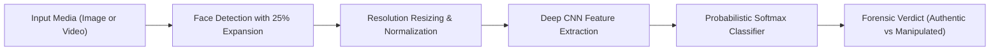
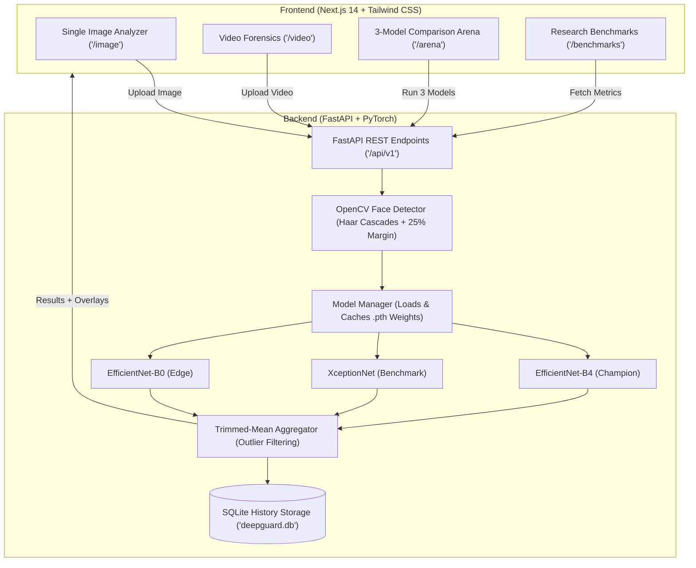

# DeepGuard AI: Deepfake Image & Video Forensic Detection System

[](https://fastapi.tiangolo.com)
[](https://pytorch.org)
[](https://nextjs.org)
[](https://tailwindcss.com)
[](LICENSE)

> **DeepGuard AI** is an explainable deep learning computer vision system built to detect AI-generated facial manipulations (deepfakes) across photos and video streams. It features an interactive **3-Model Arena**, automated **video frame sampling**, and our benchmark champion model, **EfficientNet-B4** (achieving **97.0% Accuracy** and **0.9968 ROC-AUC** on 8,938 test images).

---

## Table of Contents
1. [What is a Deepfake & Why Does Detection Matter?](#1-what-is-a-deepfake--why-does-detection-matter)
2. [How DeepGuard AI Detects Deepfakes (In Simple Words)](#2-how-deepguard-ai-detects-deepfakes-in-simple-words)
3. [The 3 Experiments & Benchmark Results](#3-the-3-experiments--benchmark-results)
4. [Why EfficientNet-B4 is the Undisputed Champion](#4-why-efficientnet-b4-is-the-undisputed-champion)
5. [System Architecture](#5-system-architecture)
6. [Interactive 3-Model Comparison Arena](#6-interactive-3-model-comparison-arena)
7. [Project Structure](#7-project-structure)
8. [Quickstart: How to Run Locally](#8-quickstart-how-to-run-locally)
9. [API Reference](#9-api-reference)
10. [Evaluation Diagnostic Plots](#10-evaluation-diagnostic-plots)

---

## 1. What is a Deepfake & Why Does Detection Matter?

A **deepfake** is an image, audio clip, or video where an artificial intelligence model has swapped one person's face onto another, animated a still face, or synthesized an entirely fake human from scratch.

While deepfake technology has fun uses in Hollywood films and video games, it is also dangerous:
- **Identity Theft & Biometric Spoofing:** Criminals generate fake faces to bypass identity verification or banking logins.
- **Disinformation:** Bad actors create fake videos of leaders or executives saying things they never said.
- **Fraud & Extortion:** Harassment through non-consensual synthetic pictures.

Because generative AI has become so advanced, the human eye often cannot tell if a face is real or synthesized. **DeepGuard AI** gives people and organizations an automated, scientific tool to check media authenticity in milliseconds.

---

## 2. How DeepGuard AI Detects Deepfakes (In Simple Words)

When a human creates a deepfake, the AI model has to blend the fake face into the real background. This leaves tiny, almost invisible digital footprints:
1. **Blurry or Warped Boundaries:** Where the synthetic face skin meets the real neck, hair, or jawline.
2. **Eye Reflection Inconsistencies:** Genuine photos have matching specular light reflections in both eyes; synthetic faces often mismatch.
3. **Texture Artifacts:** Unnatural pixel patterns in fine details like eyebrows, teeth, and earlobes.

DeepGuard AI analyzes these clues in 4 clean steps:



1. **Locate Face with Extra Margin:** OpenCV cascades locate every face in the image and expand the box by **25%** so the neural network can see the boundary where the face joins the hair and neck.
2. **Normalize:** The cropped face is normalized to match ImageNet standard distributions (`mean=[0.485, 0.456, 0.406]`, `std=[0.229, 0.224, 0.225]`).
3. **Extract Features:** The fine-tuned CNN backbone processes the image through dozens of convolutional layers, recognizing microscopic boundary anomalies.
4. **Output Verdict:** The model outputs a probability score from 0.0% to 100.0%. If the fake probability is $\ge 50\%$, it flags the face as **Likely Manipulated**; otherwise, it confirms it as **Likely Authentic**.

For videos, DeepGuard AI extracts frames every **0.75 seconds**, processes all faces, and applies **trimmed-mean aggregation** to prevent single blurry frames from throwing off the final result.

---

## 3. The 3 Experiments & Benchmark Results

We conducted three comprehensive deep learning experiments using three distinct model architectures on identical training and test splits. All models were tested on an unseen holdout set of **8,938 test images** (4,469 Real genuine faces and 4,469 Deepfake manipulated faces).

### Side-by-Side Experimental Results

| Metric / Specification | Experiment 1: EfficientNet-B0 | Experiment 2: XceptionNet | Experiment 3: EfficientNet-B4 (Champion) 🏆 |
| :--- | :---: | :---: | :---: |
| **Model Role** | Lightweight Edge Baseline | Classical Benchmark | **Production Champion** |
| **Architecture** | EfficientNet-B0 | Xception (`legacy_xception`) | **EfficientNet-B4** |
| **Input Resolution** | 224 × 224 px | 299 × 299 px | **380 × 380 px** |
| **Weights File Size** | 16.34 MB | 83.55 MB | **70.97 MB** |
| **Test Set Size** | 8,938 images | 8,938 images | **8,938 images** |
| **Test Accuracy** | 92.0% | 93.0% | **97.0% (+4.0% to +5.0%)** |
| **ROC-AUC Score** | 0.9795 | 0.9867 | **0.9968 (Near Flawless)** |
| **Deepfake Recall** | 92.9% | 95.3% | **98.2%** |
| **Missed Deepfakes** | 316 fakes missed | 210 fakes missed | **Only 80 fakes missed!** |
| **Genuine Face Precision** | 92.7% | 95.1% | **98.2%** |
| **Minimum Val Loss** | 0.175 | 0.155 | **0.075 (50% lower error)** |
| **Production Decision** | Available in Arena | Available in Arena | **Default Champion Model** |

---

## 4. Why EfficientNet-B4 is the Undisputed Champion

Based on the empirical experimental logs and confusion matrices, **EfficientNet-B4** emerged as the clear champion:

1. **62% Fewer Missed Deepfakes:**
   - In a security or forensics context, missing a deepfake (False Negative) is the worst failure.
   - XceptionNet missed **210** fakes.
   - EfficientNet-B0 missed **316** fakes.
   - **EfficientNet-B4 missed only 80 fakes out of 4,469**, catching **98.2%** of all synthetic manipulations!
2. **The 380×380 Resolution Advantage:**
   - Deepfake boundary seams, pixel blending, and eye reflections are tiny high-frequency artifacts.
   - Downscaling an image to 224×224 (B0) destroys fine boundary details.
   - EfficientNet-B4 preserves these artifacts at 380×380 resolution, giving the model clear visual evidence.
3. **Half the Loss Error:**
   - Validation loss dropped to **0.075**, more than 50% lower than Xception (0.155) and B0 (0.175), proving the model learned genuine distinguishing features rather than memorizing noise.
4. **Compact File Size:**
   - At **70.97 MB**, EfficientNet-B4 is actually smaller than Xception (83.55 MB) while delivering higher accuracy (+4.0%) and higher recall (+2.9%).

---

## 5. System Architecture

DeepGuard AI separates neural inference, media storage, background queuing, and visual presentation into distinct components:



---

## 6. Interactive 3-Model Comparison Arena

DeepGuard AI includes a dedicated **3-Model Arena** (`/arena`) where you can upload any face image and run all 3 models simultaneously.

For each model, the arena displays:
- **In-Image Detection Overlay:** Face bounding boxes and authenticity badges (`[REAL 98.4%]` or `[FAKE 99.1%]`) are drawn directly on the image.
- **Real-Time Latency & FPS:** Processing time in milliseconds and throughput (FPS) on your CPU/GPU.
- **Side-by-Side Verdicts:** Whether each model classifies the image as authentic or manipulated.
- **Probability Distribution:** Visual bars displaying Fake vs Real probability confidence.

---

## 7. Project Structure

```
07_DeepGuard_AI/
├── README.md                                  # Comprehensive documentation
├── docker-compose.yml                         # Containerized multi-service launcher
│
├── backend/                                   # FastAPI Backend Application
│   ├── requirements.txt                       # Python dependencies (torch, torchvision, fastapi, cv2)
│   ├── pytest.ini                             # Pytest configuration
│   ├── app/
│   │   ├── main.py                            # FastAPI application entrypoint & middleware
│   │   ├── config.py                          # Application settings (DEFAULT_MODEL = efficientnet_b4)
│   │   ├── api/
│   │   │   ├── routes_analysis.py             # /image, /video, /compare routes
│   │   │   ├── routes_models.py               # /models, /benchmarks routes
│   │   │   ├── routes_system.py               # /health, /system/status routes
│   │   ├── models/
│   │   │   └── schemas.py                     # Pydantic v2 schemas for all payloads
│   │   └── services/
│   │       ├── model_manager.py               # Safe weights loader and cache
│   │       ├── face_detector.py               # OpenCV face detection with margin expansion
│   │       ├── image_infer.py                 # Single-image and multi-model comparison
│   │       ├── video_infer.py                 # Asynchronous background video processing
│   │       ├── aggregator.py                  # Outlier-resilient score aggregator
│   │       └── history_service.py             # SQLite persistence
│   ├── artifacts/models/                      # Trained model checkpoints & configs
│   │   ├── efficientnet_b4/                   # 🏆 Champion Model (97.0% Acc)
│   │   │   ├── best_model.pth                 # Trained weights (70.97 MB)
│   │   │   └── model_config.json              # Architecture specification (380x380)
│   │   ├── xception/                          # Benchmark Model (93.0% Acc)
│   │   │   ├── best_model.pth                 # Trained weights (83.55 MB)
│   │   │   └── model_config.json              # Architecture specification (299x299)
│   │   └── efficientnet_b0/                   # Lightweight Edge Model (92.0% Acc)
│   │       ├── best_model.pth                 # Trained weights (16.34 MB)
│   │       └── model_config.json              # Architecture specification (224x224)
│   └── tests/                                 # 21 Automated Pytest Suites (100% passing)
│
├── frontend/                                  # Next.js 14 Light-Theme Web Application
│   ├── package.json                           # Frontend dependencies
│   ├── public/assets/                         # Evaluation diagnostic plots
│   └── src/
│       ├── app/
│       │   ├── page.tsx                       # Overview dashboard & champion highlights
│       │   ├── arena/page.tsx                 # 3-Model comparison arena (live latency & FPS)
│       │   ├── benchmarks/page.tsx            # Full 3-experiment research & diagnostic charts
│       │   ├── image/page.tsx                 # Single-image analyzer with in-image overlay
│       │   ├── video/page.tsx                 # Video analyzer with in-video telemetry
│       │   └── models/page.tsx                # Model registry & 16-step Colab guide
│       ├── components/                        # Clean, modern UI components
│       └── lib/
│           ├── api.ts                         # Typed REST API client
│           └── types.ts                       # TypeScript interfaces
│
└── training/                                  # Google Colab Training Pipeline
    ├── notebooks/                             # Jupyter notebooks (00-05)
    └── src/models/
        ├── efficientnet.py                    # EfficientNet-B0 & EfficientNet-B4 definitions
        ├── xception.py                        # XceptionNet definition
        └── factory.py                         # Model loader & checkpoint key adapter
```

---

## 8. Quickstart: How to Run Locally

### Prerequisites
- **Python 3.10+** (tested on Python 3.11)
- **Node.js 18+** (tested on Node.js 20)
- **Git**

### Step 1: Start the Backend (FastAPI)

1. Open a terminal in the backend directory:
   ```bash
   cd 07_DeepGuard_AI/backend
   ```
2. Create and activate a virtual environment (optional but recommended):
   ```bash
   python -m venv venv
   # On Windows:
   .\venv\Scripts\activate
   # On Linux/macOS:
   source venv/bin/activate
   ```
3. Install requirements:
   ```bash
   pip install -r requirements.txt
   ```
4. Run the backend server:
   ```bash
   uvicorn app.main:app --reload --host 0.0.0.0 --port 8000
   ```
   *The API will be available at: http://localhost:8000 (Swagger docs at http://localhost:8000/docs).*

5. Run test suite:
   ```bash
   pytest
   ```
   *(All 21 unit & integration tests should pass in ~10-15s).*

### Step 2: Start the Frontend (Next.js)

1. Open a second terminal in the frontend directory:
   ```bash
   cd 07_DeepGuard_AI/frontend
   ```
2. Install dependencies (if not already installed):
   ```bash
   npm install
   ```
3. Start the Next.js development server:
   ```bash
   npm run dev
   ```
4. Open your browser and navigate to:
   - **Dashboard:** [http://localhost:3000](http://localhost:3000)
   - **3-Model Arena:** [http://localhost:3000/arena](http://localhost:3000/arena)
   - **Research Benchmarks:** [http://localhost:3000/benchmarks](http://localhost:3000/benchmarks)
   - **Image Forensics:** [http://localhost:3000/image](http://localhost:3000/image)
   - **Video Forensics:** [http://localhost:3000/video](http://localhost:3000/video)

---

## 9. API Reference

| Method | Endpoint | Description |
| :--- | :--- | :--- |
| `GET` | `/api/v1/health` | Health probe returning service status. |
| `GET` | `/api/v1/system/status` | Reports GPU availability, CUDA device, and ready models. |
| `GET` | `/api/v1/models` | Lists all 3 supported models and local checkpoint availability. |
| `GET` | `/api/v1/models/benchmarks` | Returns full metrics table and diagnostic image URLs for all 3 models. |
| `POST` | `/api/v1/analysis/image` | Analyzes a single image using the specified model (defaults to B4). |
| `POST` | `/api/v1/analysis/compare` | Runs all 3 models on the image and returns latency (ms), FPS, and verdicts. |
| `POST` | `/api/v1/analysis/video` | Enqueues a video for asynchronous frame extraction and returns `analysis_id`. |
| `GET` | `/api/v1/analysis/{id}` | Polls processing progress or retrieves completed video report. |
| `GET` | `/api/v1/analysis/history/list` | Returns paginated analysis history from SQLite. |

---

## 10. Evaluation Diagnostic Plots

The evaluation plots generated during the experimental runs are preserved directly in `07_DeepGuard_AI/frontend/public/assets/` and `07_DeepGuard_AI/docs/assets/`:

- **EfficientNet-B4 (Champion):**
  - Metrics & Confusion Matrix: [efficientnet_b4_metrics.png](docs/assets/efficientnet_b4_metrics.png)
  - Loss & ROC-AUC Curve: [efficientnet_b4_roc.png](docs/assets/efficientnet_b4_roc.png)
- **XceptionNet (Benchmark):**
  - Metrics & Confusion Matrix: [xception_metrics.png](docs/assets/xception_metrics.png)
  - Loss & ROC-AUC Curve: [xception_roc.png](docs/assets/xception_roc.png)
- **EfficientNet-B0 (Edge):**
  - Metrics & Confusion Matrix: [efficientnet_b0_metrics.png](docs/assets/efficientnet_b0_metrics.png)
  - Loss & ROC-AUC Curve: [efficientnet_b0_roc.png](docs/assets/efficientnet_b0_roc.png)

---

## License

This project is open-source under the [MIT License](LICENSE).
