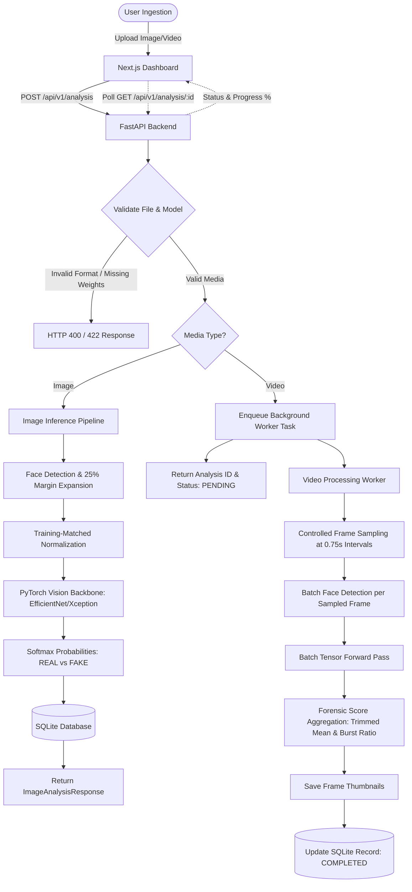

# DeepGuard AI — System Architecture & Data Flow

## 1. System Overview

DeepGuard AI is structured as a modular, decoupled deepfake forensic analysis platform consisting of:
1. **Next.js Forensic Dashboard (Frontend)**: Real-time user interface with drag-and-drop ingestion, interactive face bounding-box inspection, frame scrubber timeline, and forensic report downloads.
2. **FastAPI Application Server (Backend)**: High-performance asynchronous REST API coordinating input validation, background task orchestration, SQLite persistence, and model loading.
3. **Face Extraction Service**: OpenCV Haar Cascade detector expanded with a 25% boundary context margin to capture facial seams, hairline blends, and jawline manipulation artifacts.
4. **Controlled Video Sampler**: Video decoding pipeline that extracts frames at configurable temporal intervals (e.g., 1 frame per 0.75s) up to a safety ceiling (40 frames).
5. **Inference & Aggregation Engine**: Fine-tuned vision backbones (EfficientNet-B0 and XceptionNet) running under PyTorch with automatic CUDA acceleration, combined with an outlier-resistant trimmed-mean aggregator.

---

## 2. End-to-End Processing Workflow

---

## 3. Core Architectural Principles

### 3.1 Strict Separation of Concerns
No machine learning inference or heavy disk I/O takes place within route handlers. API routes are strictly validation and dispatch layers:
- Routes delegate to `image_infer_service` or `video_infer_service`.
- Model lifecycle and weight loading is centralized in `model_manager`.
- Database operations are encapsulated within `history_service`.
- Reporting and PDF/HTML generation are isolated in `report_service`.

### 3.2 Non-Blocking Video Ingestion
Video files can range from 10 MB to 150 MB. Synchronous HTTP processing would lead to connection timeouts and poor UX. DeepGuard AI uses FastAPI's `BackgroundTasks` with persistent state tracking:
1. `PENDING`: File uploaded and verified.
2. `PROCESSING`: Frame extraction, face detection, and model forward pass in progress (progress 10%–90%).
3. `COMPLETED`: Score aggregation done, thumbnails saved, final verdict recorded.
4. `FAILED`: Gracefully records error message without crashing server.

### 3.3 Verifiable Model Loading & No Simulation
If model checkpoint files (`best_model.pth`) are missing from `artifacts/models/`, the backend **never** simulates confidence scores or fakes predictions. Instead, it raises a typed `CheckpointMissingError` that informs the client that training must first be executed in Google Colab.
