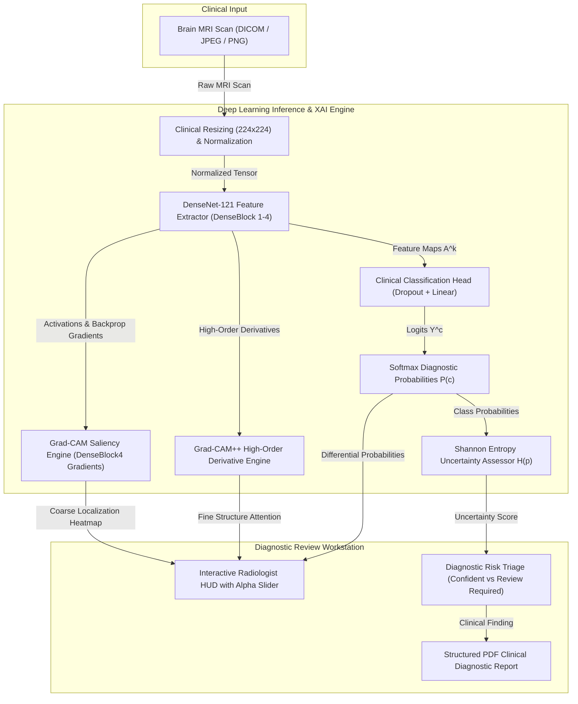

# NeuroScan XAI: Explainable Deep Learning for Brain MRI Tumor Diagnosis

**NeuroScan XAI** is an interpretable clinical computer vision system for **multi-class brain tumor classification and weakly-supervised localization** from magnetic resonance imaging (MRI) scans. Engineered for high-stakes medical diagnosis where uninterpretable "black-box" models are unacceptable, it pairs high-capacity feature extraction (**DenseNet-121**) with native **Grad-CAM**, **Grad-CAM++**, and **Shannon Softmax Entropy** uncertainty quantification.

---

## 1. Clinical Scope & Diagnostic Classes

The framework provides 4-way differential diagnosis on cranial axial, coronal, and sagittal T1/T2-weighted MRI scans:

| Class | Anatomical Origin | Pathological Presentation |
| :--- | :--- | :--- |
| **Glioma** | Glial tissue (astrocytes, oligodendrocytes) | Infiltrative parenchymal tumor, ill-defined margins, frequent surrounding edema and central necrosis. |
| **Meningioma** | Arachnoid villi (meninges) | Extra-axial, well-circumscribed, dural-based mass compressing adjacent brain parenchyma. |
| **Pituitary Tumor** | Anterior pituitary gland | Sellar/suprasellar adenoma localized within the sella turcica near the optic chiasm. |
| **No Tumor** | Normal cranial anatomy | Normal cerebral hemispheres, cerebellum, ventricular system, and no focal pathological enhancement. |

---

## 2. System Architecture

---

## 3. Mathematical Foundations

### 3.1 DenseNet-121 Feature Reuse
Unlike standard residual architectures that combine feature maps via summation ($x + f(x)$), DenseNet concatenates all preceding feature representations:
$$x_\ell = H_\ell([x_0, x_1, \dots, x_{\ell-1}])$$
This architectural choice preserves high-frequency edge textures (such as meningeal borders and micro-necrosis) into the final convolutional layer (`features.denseblock4`), producing sharp localization maps without gradient decay.

### 3.2 Grad-CAM Mathematical Formulation
Given class score $Y^c$ for tumor pathology $c$, gradients are backpropagated to feature map $A^k$ of the last convolutional block:
$$\alpha_k^c = \frac{1}{Z} \sum_{i=1}^U \sum_{j=1}^V \frac{\partial Y^c}{\partial A_{i,j}^k}$$
$$L_{\text{Grad-CAM}}^c = \text{ReLU}\left( \sum_k \alpha_k^c A^k \right)$$

### 3.3 Grad-CAM++ (Second & Third Order Derivatives)
For diffuse glial tumors or multi-focal presentations, Grad-CAM++ weights gradients per-pixel using higher-order partial derivatives:
$$w_k^c = \sum_{i=1}^U \sum_{j=1}^V \alpha_{i,j}^{kc} \cdot \text{ReLU}\left( \frac{\partial Y^c}{\partial A_{i,j}^k} \right)$$
where $\alpha_{i,j}^{kc}$ are calculated analytically from $\frac{\partial^2 Y^c}{\partial (A_{i,j}^k)^2}$ and $\frac{\partial^3 Y^c}{\partial (A_{i,j}^k)^3}$.

### 3.4 Diagnostic Uncertainty (Shannon Entropy)
To prevent erroneous automated diagnoses on borderline cases, predictive entropy is calculated:
$$H(p) = -\sum_{c=1}^4 p_c \log_2(p_c), \quad H(p) \in [0, 2.0]$$
* **$H(p) < 0.40$:** High diagnostic certainty &rarr; Automated preliminary triage.
* **$0.40 \le H(p) < 0.85$:** Moderate uncertainty &rarr; Standard radiologist review.
* **$H(p) \ge 0.85$:** High diagnostic ambiguity &rarr; Mandatory senior specialist review.

---

## 4. Google Colab Master Training Guide

The training notebook is self-contained and pre-configured for a free Google Colab GPU runtime (Tesla T4).

### Step 1: Open Notebook in Google Colab
1. Navigate to [Google Colab](https://colab.research.google.com/).
2. Select **Upload** and upload:
   `09_NeuroScan_XAI/notebooks/01_neuroscan_xai_brain_tumor_training.ipynb`
3. In Colab, select **Runtime &rarr; Change runtime type &rarr; T4 GPU**.

### Step 2: Execute All Cells
* **Cell 2 & 3:** Automatically installs dependencies and downloads the ~150 MB dataset via `kagglehub` in under 15 seconds.
* **Cell 4 & 5:** Prepares the 4 diagnostic classes and loads augmentation pipelines.
* **Cell 6 & 7:** Builds DenseNet-121 and hooks native Grad-CAM & Grad-CAM++ engines.
* **Cell 8:** Executes mixed-precision (`fp16`) training for 15 epochs (~8–10 minutes total).
* **Cell 9 & 10:** Generates ROC-AUC curves, Confusion Matrix, and clinical classification reports.
* **Cell 11:** Renders side-by-side original MRI vs. Grad-CAM vs. Grad-CAM++ visualizations.
* **Cell 12:** Automatically packages `best_densenet121.pth` and `model_metadata.json` into `neuroscan_model_package.zip` and triggers a browser download.

### Step 3: Copy Model Checkpoint to Local Project
Once downloaded, place `best_densenet121.pth` and `model_metadata.json` into:
`09_NeuroScan_XAI/backend/artifacts/models/`
