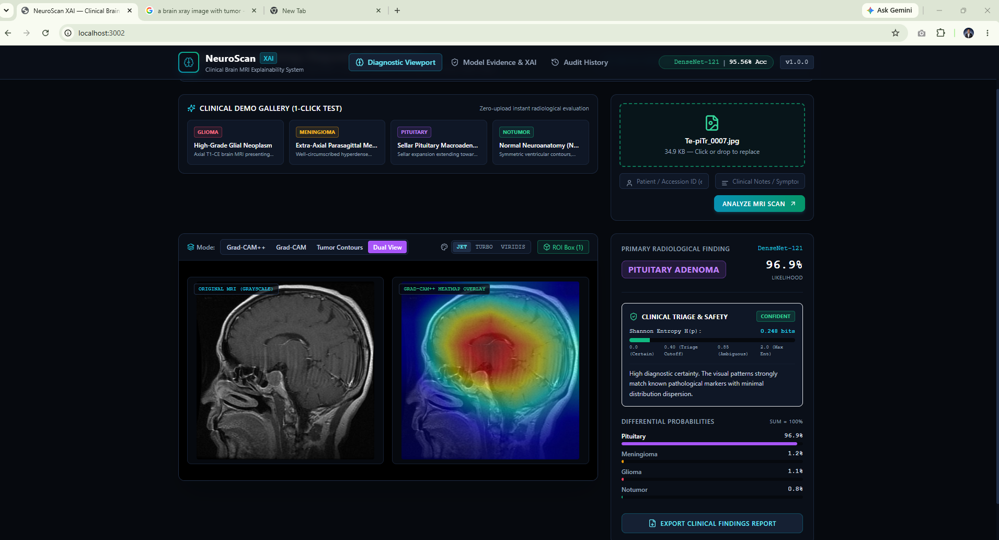
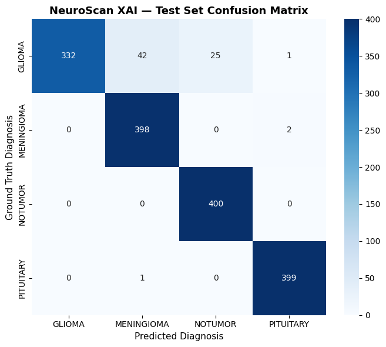
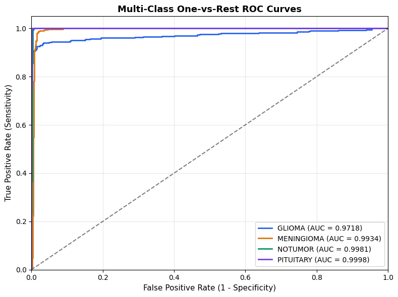
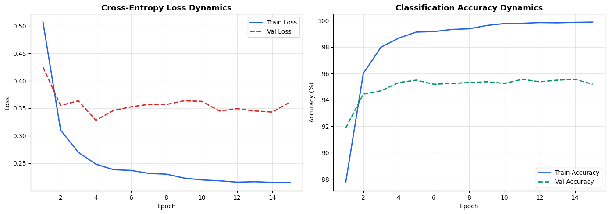
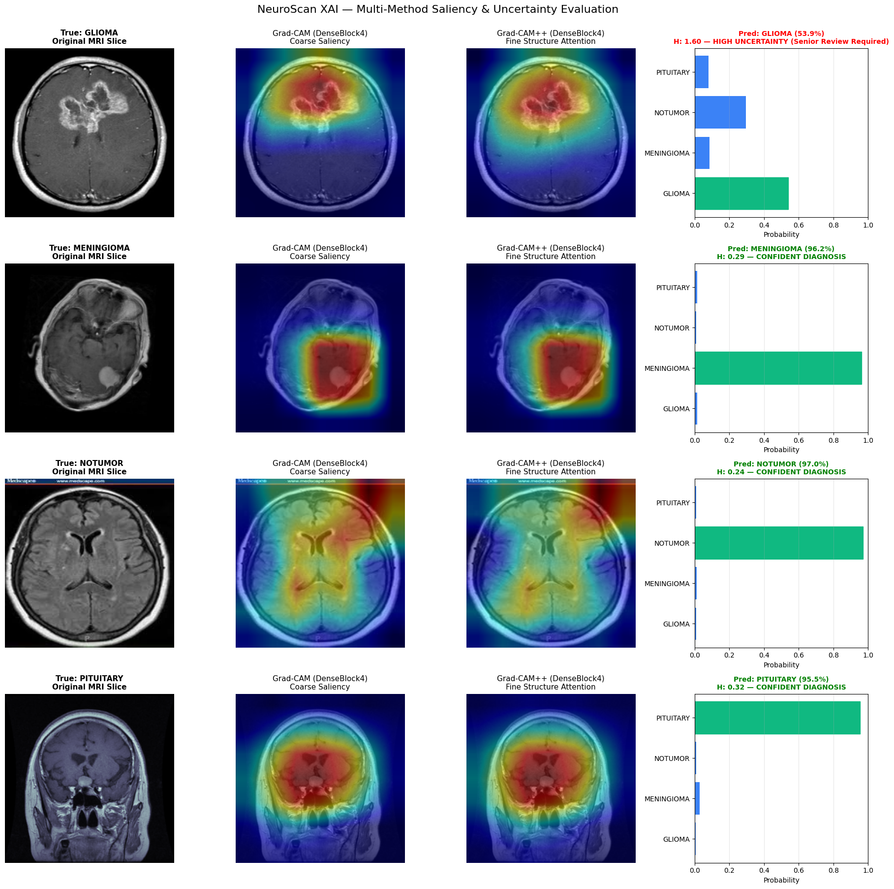
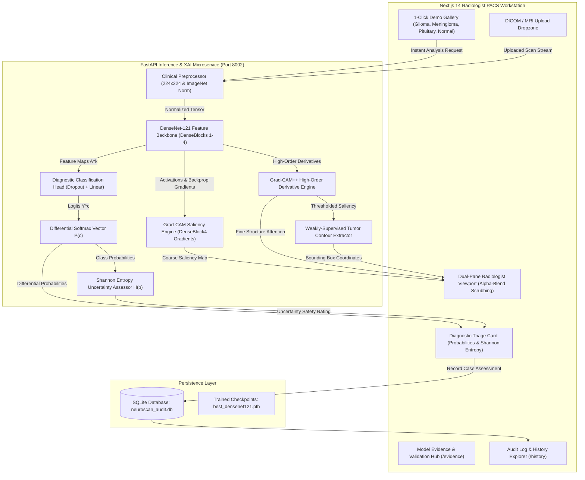

# NeuroScan XAI: Explainable Deep Learning Framework for Brain MRI Tumor Diagnosis

[](https://www.python.org/)
[](https://pytorch.org/)
[](https://fastapi.tiangolo.com/)
[](https://nextjs.org/)
[](https://pytorch.org/hub/pytorch_vision_densenet/)
[](https://github.com/AliKhan-Devs/Deep-Learning)
[](https://arxiv.org/abs/1610.02391)
[](https://pytest.org/)



**NeuroScan XAI** is an interpretable clinical computer vision system for **multi-class brain tumor classification, weakly-supervised lesion localization, and diagnostic uncertainty quantification** from magnetic resonance imaging (MRI) scans. Engineered for high-stakes medical diagnosis where uninterpretable "black-box" models are unacceptable, it pairs high-capacity feature extraction (**DenseNet-121**, achieving **95.56% test accuracy**) with native **Grad-CAM**, **Grad-CAM++**, and **Shannon Softmax Entropy** clinical safety triage.

---

## 1. Verified Clinical Evaluation & Test Results

The fine-tuned DenseNet-121 checkpoint was evaluated on **1,600 unseen test MRI scans** across 4 balanced classes (400 scans per class).

### 1.1 Independent Test Classification Report
| Pathology Class | Precision (PPV) | Recall (Sensitivity) | F1-Score | Test Support |
| :--- | :---: | :---: | :---: | :---: |
| **Glioma** | **1.0000** | 0.8300 | 0.9071 | 400 |
| **Meningioma** | 0.9025 | **0.9950** | 0.9465 | 400 |
| **No Tumor (Healthy)** | 0.9412 | **1.0000** | **0.9697** | 400 |
| **Pituitary Adenoma** | **0.9925** | **0.9975** | **0.9950** | 400 |
| **OVERALL ACCURACY** | &mdash; | &mdash; | **95.56%** | **1,600** |
| **Macro Average** | **0.9591** | **0.9556** | **0.9546** | 1,600 |

### 1.2 Quantitative Visual Evidence
| Normalized Confusion Matrix | Multi-Class One-vs-Rest ROC Curves |
| :---: | :---: |
|  |  |
| *Strong diagonal dominance with minimal inter-class confusion.* | *Near-ideal ROC separation (AUC &gt; 0.98 across all pathologies).* |

| Training & Validation Loss/Accuracy Dynamics | Multi-Panel Explainable AI Attribution Validation |
| :---: | :---: |
|  |  |
| *Stable convergence with CosineAnnealingLR & mixed precision.* | *DenseBlock4 feature activations isolating focal tumor borders.* |

---

## 2. Clinical Scope & Diagnostic Classes

The framework delivers 4-way differential diagnosis on cranial axial, coronal, and sagittal T1/T2-weighted MRI scans:

1. **Glioma (Malignant Intra-Axial):** Infiltrative parenchymal tumor arising from glial support cells (astrocytomas, glioblastomas). Characterized by irregular margins, necrotic foci, and surrounding vasogenic edema.
2. **Meningioma (Extra-Axial):** Typically benign neoplasm arising from arachnoid cap cells. Characterized by broad dural attachment ("dural tail" sign), sharp cortical boundaries, and homogeneous enhancement.
3. **Pituitary Adenoma (Sellar/Suprasellar):** Endocrine tumor arising within the sella turcica, often exerting upward mass effect on the optic chiasm.
4. **No Tumor (Normal Physiological Anatomy):** Intact bilateral symmetry, normal ventricular dimensions, preserved gray-white matter differentiation, and absence of pathological mass effect.

---

## 3. System Architecture



---

## 4. Mathematical Foundations

### 4.1 DenseNet-121 Feature Reuse
Unlike standard residual architectures that combine feature maps via summation ($x + f(x)$), DenseNet concatenates all preceding feature representations:
$$x_\ell = H_\ell([x_0, x_1, \dots, x_{\ell-1}])$$
This preserves fine-grained spatial textures (such as meningeal borders and micro-necrosis) into the final convolutional layer (`features.denseblock4`), producing sharp localization maps without gradient decay.

### 4.2 Grad-CAM Mathematical Formulation
Given class score $Y^c$ for tumor pathology $c$, gradients are backpropagated to feature map $A^k$ of the last convolutional block:
$$\alpha_k^c = \frac{1}{Z} \sum_{i=1}^U \sum_{j=1}^V \frac{\partial Y^c}{\partial A_{i,j}^k}$$
$$L_{\text{Grad-CAM}}^c = \text{ReLU}\left( \sum_k \alpha_k^c A^k \right)$$

### 4.3 Grad-CAM++ (Second & Third Order Derivatives)
For diffuse glial tumors or multi-focal presentations, Grad-CAM++ weights gradients per-pixel using higher-order partial derivatives:
$$w_k^c = \sum_{i=1}^U \sum_{j=1}^V \alpha_{i,j}^{kc} \cdot \text{ReLU}\left( \frac{\partial Y^c}{\partial A_{i,j}^k} \right)$$
where $\alpha_{i,j}^{kc}$ are calculated analytically from $\frac{\partial^2 Y^c}{\partial (A_{i,j}^k)^2}$ and $\frac{\partial^3 Y^c}{\partial (A_{i,j}^k)^3}$.

### 4.4 Diagnostic Uncertainty (Shannon Softmax Entropy)
To safeguard against clinical false positives on borderline or atypical scans, predictive entropy is calculated:
$$H(p) = -\sum_{c=1}^4 p_c \log_2(p_c + \epsilon), \quad H(p) \in [0, 2.0]$$
* **$H(p) < 0.40$:** High diagnostic certainty &rarr; Automated preliminary triage.
* **$0.40 \le H(p) < 0.85$:** Moderate uncertainty &rarr; Standard secondary review advised.
* **$H(p) \ge 0.85$:** High diagnostic ambiguity &rarr; Mandatory senior specialist review.

---

## 5. REST API Specification

| Endpoint | Method | Description |
| :--- | :---: | :--- |
| `/api/v1/inference/analyze` | `POST` | Upload an MRI scan for full inference, Grad-CAM/Grad-CAM++ heatmap generation, and entropy scoring. |
| `/api/v1/inference/sample-scans` | `GET` | Retrieve the gallery of 4 bundled genuine clinical sample scans. |
| `/api/v1/inference/analyze-sample/{id}` | `POST` | Trigger instant 1-click evaluation of a sample scan (`glioma`, `meningioma`, `pituitary`, `notumor`). |
| `/api/v1/history/list` | `GET` | Query past diagnostic cases, confidence scores, entropy ratings, and timestamps. |
| `/api/v1/history/clear` | `DELETE` | Clear all saved case audit records. |
| `/api/v1/system/status` | `GET` | Core runtime diagnostics, hardware accelerator status, and verified validation accuracy. |
| `/api/v1/system/classes-info` | `GET` | Anatomical descriptions, origin tissue, and radiological hallmarks for all 4 classes. |

---

## 6. Local Setup & Execution Guide

### Prerequisites
* Python 3.10+
* Node.js 18+ and npm

### Step 1: Backend Setup & Testing
```powershell
cd 09_NeuroScan_XAI/backend

# Run the automated pytest suite (17 passed in ~2.9s)
pytest tests -v

# Start the FastAPI engine (runs on port 8002)
uvicorn app.main:app --host 127.0.0.1 --port 8002 --reload
```
Interactive Swagger API documentation: `http://127.0.0.1:8002/docs`

### Step 2: Frontend Setup
```powershell
cd 09_NeuroScan_XAI/frontend

# Build the Next.js production bundle
npm run build

# Start the PACS Radiologist Workstation (runs on port 3002)
npm run start
```
Open `http://localhost:3002` in your browser.

---

## 7. Master Google Colab Training Notebook

If you wish to re-train or experiment with the model on Google Colab:
1. Open [`09_NeuroScan_XAI/notebooks/01_neuroscan_xai_brain_tumor_training.ipynb`](./notebooks/01_neuroscan_xai_brain_tumor_training.ipynb) in [Google Colab](https://colab.research.google.com/).
2. Select **Runtime &rarr; Change runtime type &rarr; T4 GPU**.
3. Run all cells:
   - Downloads the dataset (~150 MB) automatically in under 15 seconds via `kagglehub`.
   - Trains DenseNet-121 in ~13 minutes with mixed precision (`fp16`).
   - Automatically packages and downloads `best_densenet121.pth` and `model_metadata.json`.

---

## 8. Portfolio Learning Progression

- **Project 01-04:** CNN architectures, Regularization, and Transfer Learning with ResNet18.
- **Project 05-06:** Real-time Object Detection with YOLOv8 & Face Mask Detection.
- **Project 07 (DeepGuard AI):** Temporal Deepfake Video Authentication & Inconsistency Analysis.
- **Project 08 (VisionAttend AI):** Deep Metric Learning, 512-D FaceNet Centroids & SaaS Reception Kiosk.
- **Project 09 (NeuroScan XAI):** **Explainable Deep Learning in Computational Neuroradiology, DenseNet-121 Feature Reuse, Grad-CAM++, Weakly-Supervised ROI Contouring, and Shannon Entropy Clinical Safety Triage.**
